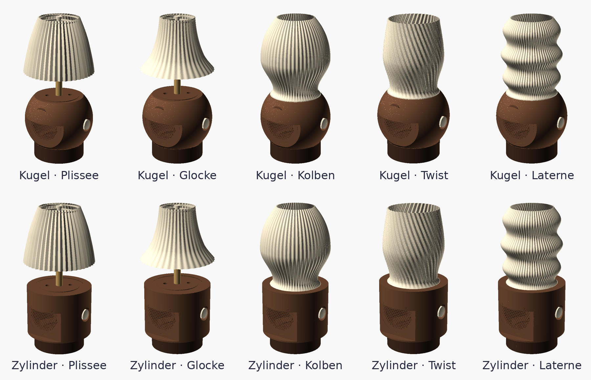

<picture><source media="(prefers-color-scheme: dark)" srcset="docs/logo/dark_logo.png"></picture>

# Dusk & Dawn – Schlafsounds, Wecker und Sonnenaufgang für Home Assistant

**Dusk & Dawn** macht aus jedem Lautsprecher und jeder Lampe in Home Assistant eine Einschlafhilfe mit Wecker: Regen, Meer, Wind, Gewitter, Ventilator und White/Pink/Brown Noise lassen sich frei mischen, dazu kommen **eigene Aufnahmen** (beliebig viele, mit eigenem Namen), eigene Klangwelten, Sleep-Timer, Lichtwecker mit Sonnenaufgang und eine Automatik per Präsenzmelder. Bedient wird alles in einer eigenen Seitenleiste, Helfer, Skripte oder YAML braucht es nicht.

*Sleep sounds and white noise machine for Home Assistant: rain, ocean waves, wind, thunder, fan, white/pink/brown noise, your own recordings, sleep timer, sunrise alarm and presence automation. Works with any media player (Sonos, Google Nest, Music Assistant, AirPlay …) and any light, with its own sidebar panel.*

## Was die Integration kann

- **Klänge mischen:** acht Klänge einzeln regelbar, als Klangwelt speicherbar. Die Klänge werden **in Home Assistant berechnet** (Klangkern in Rust, für x86_64 und aarch64 fertig dabei) und als Stream an den Lautsprecher geschickt. Es werden keine Audiodateien mitgeliefert, nichts wiederholt sich hörbar.
- **Eigene Klänge:** beliebig viele eigene Aufnahmen hochladen und benennen, lückenlos und ohne hörbare Schleife abgespielt, im Mischpult wie jeder andere Klang.
- **Sleep-Timer** mit sanftem Ausblenden, **Wecker** (mehrere Weckzeiten, Wochentage, Weckton, Sonnenaufgang davor).
- **Licht:** Sonnenaufgang, Einschlaflicht und Kerzenflackern auf jeder Lampe (Helligkeit und Farbtemperatur).
- **Automatik:** Start nur, wenn jemand mindestens 10 Minuten im Raum ist, oder nach Zeitfenster; Stopp, wenn niemand mehr da ist; Pause bei Musik.
- **Mehrere Zimmer:** jeder Schlafplatz hat eigenen Lautsprecher, eigene Lampen und Einstellungen.

Funktionen, Bedienung, Entitäten und Grenzen: **[docs/DUSK_AND_DAWN.md](docs/DUSK_AND_DAWN.md)**

## Voraussetzungen

- Home Assistant 2025.1 oder neuer
- ein Lautsprecher, der in Home Assistant als Media Player erscheint (Sonos, Google/Nest, Music Assistant, Squeezebox, AirPlay …); Echo/Alexa geht nicht
- optional: Lampen (`light`-Entitäten) und ein Präsenzmelder

## Installation über HACS

1. In HACS **Dusk & Dawn** suchen und **Herunterladen**. Ist die Integration noch nicht im Standard-Katalog, über ⋮ → **Benutzerdefinierte Repositories** → `https://github.com/PXLJAKE/Dusk-Dawn`, Typ **Integration** hinzufügen.
2. Home Assistant neu starten.
3. **Einstellungen → Geräte & Dienste → Integration hinzufügen → Dusk & Dawn**. Schlafplatz mit Lautsprecher, Lampen und optional Präsenzmelder anlegen. Danach erscheint **Dusk & Dawn** in der Seitenleiste.

Updates bietet HACS automatisch an, sobald eine neue Version veröffentlicht ist.

## Dokumentation

| Thema | Datei |
|---|---|
| Bedienung, Entitäten, Aktionen, Grenzen | [docs/DUSK_AND_DAWN.md](docs/DUSK_AND_DAWN.md) |
| Eigene Aufnahmen hochladen und benennen | [docs/EIGENE_AUFNAHMEN.md](docs/EIGENE_AUFNAHMEN.md) |
| Wie die Klänge entstehen | [docs/SOUND_DESIGN.md](docs/SOUND_DESIGN.md) |
| Schnittstellen Integration ↔ Seitenleiste ↔ Gerät | [docs/CONTRACT.md](docs/CONTRACT.md) |
| Online-Demo der Seitenleiste | https://claude.ai/artifact/DLmL7VoFJZXLVwC1FM6WSx |

## Optional: eigene Hardware, die Soundlampe

Die Integration funktioniert komplett ohne eigene Hardware. Wer will, baut sich zusätzlich die **Soundlampe**: eine Nachttischlampe mit Raspberry Pi, eingebautem Lautsprecher und LED-Lichtkern, wahlweise mit Kugel- oder Zylinderfuß und fünf Schirmen. Anders als bei einem normalen Lautsprecher werden die Klänge dort **direkt auf dem Raspberry Pi** berechnet, ohne Stream-Verzögerung, und der Wecker klingelt auch, wenn Home Assistant oder das WLAN ausfällt. Musik spielt die Lampe per **AirPlay 2**, **Spotify Connect** und **Music Assistant**, gleichzeitig mit den Schlafgeräuschen. Die Integration erkennt sie über MQTT.

Bauanleitung, Teileliste und Druckpakete: [`hardware/`](hardware/README.md).

## Ordner

| Ordner | Inhalt |
|---|---|
| `custom_components/dusk_dawn/` | Home-Assistant-Integration (über HACS installierbar) |
| `core/` | Klangkern in Rust (Python-Paket `dusk_dawn_core`) |
| `tests/` | Tests der Integration |
| `docs/` | Dokumentation der Integration |
| `hardware/` | Optional: Soundlampe zum Selberbauen (Pi-Software, Gehäuse, Druckpakete, Anleitungen) |

## Mitmachen

Fehler und Wünsche bitte als [Issue](https://github.com/PXLJAKE/Dusk-Dawn/issues) melden. Tests: `python -m pytest tests` (siehe [Entwicklung](docs/DUSK_AND_DAWN.md#entwicklung)).
