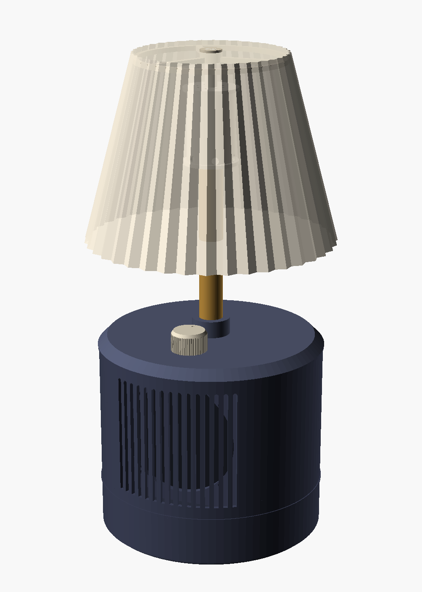

# Dusk & Dawn – Schlafsounds, Wecker und Sonnenaufgang für Home Assistant

**Schlafgeräusche für Home Assistant:** Regen, Meer, Gewitter, Kaminfeuer, Vögel, Wind, Ventilator, White/Pink/Brown Noise, frei mischbar, mit Sleep-Timer, Lichtwecker (Sonnenaufgang) und Wecker. Läuft als HACS-Integration mit eigener Seitenleiste auf jedem Lautsprecher (Sonos, Google Nest, Music Assistant …) und mit jeder Lampe. Dazu gibt es eine DIY-Soundlampe mit Raspberry Pi zum Selberbauen.

*Sleep sounds / white noise machine for Home Assistant: rain, ocean waves, thunderstorm, fireplace, birds, brown noise, sleep timer, sunrise alarm. HACS custom integration with sidebar panel, works with any media player and light.*

## SleepGenerator – Soundlampe

Retro-Tischlampe fürs Bett mit eingebautem Lautsprecher: Regen, Meer, Gewitter, Wind, Kaminfeuer, Vögel, Ventilator und White/Pink/Brown Noise, frei mischbar, mit Sleep-Timer, Aufwachlicht und Musikplayer in Home Assistant.

- **Neu: Dusk & Dawn, die Home-Assistant-Integration mit eigener Seitenleiste für beliebige Lautsprecher und Lampen:** [docs/DUSK_AND_DAWN.md](docs/DUSK_AND_DAWN.md)
- **Online-Demo:** https://claude.ai/artifact/DLmL7VoFJZXLVwC1FM6WSx
- **Plan und Überblick:** [docs/PLAN.md](docs/PLAN.md)
- **Komponenten und Verdrahtung:** [docs/HARDWARE.md](docs/HARDWARE.md)
- **Einrichtung (Pi, Home Assistant, Music Assistant):** [docs/SETUP.md](docs/SETUP.md)
- **Aufbau der Lampe (Elektronikfach, Lichtkern, Zusammenbau):** [docs/AUFBAU.md](docs/AUFBAU.md)
- **Sound-Design (wie die Klänge entstehen, Wecker):** [docs/SOUND_DESIGN.md](docs/SOUND_DESIGN.md)
- **Stromlaufplan, Pinbelegung, Lochraster-Plan:** [docs/wiring/](docs/wiring/)
- **PDFs:** [Bauanleitung](docs/pdf/Soundlampe_Bauanleitung.pdf) und [Präsentation](docs/pdf/Soundlampe_Praesentation.pdf)
- **Gehäuse zum 3D-Druck:** [enclosure/](enclosure/README.md)

| Ordner | Inhalt |
|---|---|
| `device/` | Software für den Raspberry Pi (3 A+ oder Zero 2 W): Sound-Engine, Lampe, Drehknopf, Home Assistant (MQTT) |
| `custom_components/dusk_dawn/` | Home-Assistant-Integration Dusk & Dawn (über HACS installierbar) |
| `core/` | Klangkern in Rust (Python-Paket `dusk_dawn_core`) |
| `homeassistant/` | Paket und Dashboard für die Lampe ohne Integration (Entitäten an die eigenen anpassen) |
| `enclosure/` | OpenSCAD-Modell, STL-Dateien, Renderbilder |
| `demo/` | Online-Demo (eine HTML-Datei, Web Audio) |
