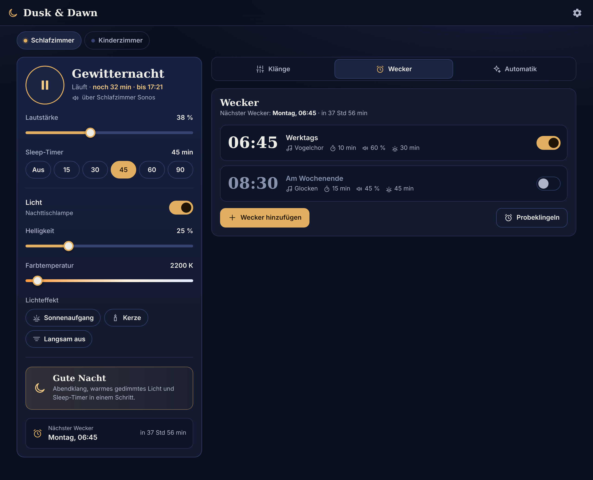

# Dusk & Dawn – Home-Assistant-Integration

Dusk & Dawn bringt Schlafgeräusche, Aufwachlicht und Wecker als normale Integration in Home Assistant. Sie läuft mit **jedem Lautsprecher**, der in HA als Media Player auftaucht (Sonos, Google/Nest, Music Assistant, Squeezebox …), und **jeder Lampe**. Die Klänge werden **in Home Assistant berechnet** und an den Lautsprecher gestreamt; eigene Hardware ist nicht nötig. Die selbstgebaute [Soundlampe](../hardware/README.md) ist nur ein optionales Gerät unter vielen. Helfer, Automationen oder YAML braucht man nicht.

## Installation über HACS

1. In HACS „Dusk & Dawn“ suchen. Ist es noch nicht im Katalog: ⋮ → **Benutzerdefinierte Repositories** → `https://github.com/PXLJAKE/Dusk-Dawn`, Typ **Integration**.
2. **Herunterladen**, Home Assistant neu starten.
3. **Einstellungen → Geräte & Dienste → Integration hinzufügen → Dusk & Dawn**.
4. Einen Schlafplatz anlegen: Name, Lautsprecher, Lampen und (optional) Präsenzmelder auswählen. Für weitere Zimmer einfach noch einmal hinzufügen.

Danach erscheint links in der Seitenleiste **Dusk & Dawn**.

## Bedienung

- **Jetzt:** Start/Stopp, Lautstärke, Sleep-Timer und Licht.
- **Klänge:** Klangwelten antippen oder im Mischpult jeden der acht eingebauten Klänge (Regen, Meer, Wind, Gewitter, Ventilator, White/Pink/Brown Noise) und jeden eigenen Klang einzeln einstellen und als eigene Klangwelt speichern. Die Gruppe **Eigene** zeigt die eigenen Klänge: beliebig viele anlegen, benennen, mit Aufnahmen füllen ([Anleitung](EIGENE_AUFNAHMEN.md)).
- **Wecker:** beliebig viele Weckzeiten mit Wochentagen, Weckton (Glocken, Klassisch, Vogelchor) mit Vorhören, Dauer, Lautstärke und Sonnenaufgang davor.
- **Automatik:** Start im Zeitfenster entweder erst, wenn jemand mindestens 10 Minuten (einstellbar) im Raum ist, oder nur nach Zeitraum ohne Sensor (Start zu Beginn, Stopp am Ende). Aus, wenn niemand mehr da ist. Pause bei Musik. Ein ausgeschalteter Sleep-Timer bleibt aus.
- **Lautstärke:** Die Klänge sind absichtlich leiser als Musik über AirPlay oder Music Assistant. Regler ganz oben entspricht −18 dB, bei 50 % sind es etwa −38 dB. Der Wecker ist zusätzlich um 12 dB gedämpft. Mit der DIY-Soundlampe rechnet die Lampe diese Kurve selbst, sie braucht dafür das aktuelle Update.
- **Zahnrad:** Lautsprecher, Lampen und Melder ändern.
- **Sonne/Mond oben rechts:** Design wechseln: wie Home Assistant (automatisch), hell oder dunkel. Die Wahl merkt sich jeder Browser selbst.

Für eigene Automationen gibt es pro Schlafplatz Entitäten (Schalter, Klangwelt, Lautstärke, Timer, nächster Wecker …) und die Aktionen `dusk_dawn.play`, `stop`, `good_night`, `ring` und `stop_alarm`.

## Wo die Klänge entstehen

**Als reine Integration** (normaler Lautsprecher): Home Assistant berechnet die Geräusche selbst und stellt sie als MP3-Stream bereit, den der Lautsprecher wie ein Internetradio abspielt. Dadurch reagieren Sonos- und Google-Lautsprecher auf Regler mit 2–10 s Verzögerung. Der Klangkern ist in Rust geschrieben (`core/`) und liegt für x86_64 und aarch64 fertig gebaut bei; er braucht für vier Klänge etwa 0,5 % eines CPU-Kerns. Auf anderen Systemen nutzt die Integration automatisch die langsamere Python-Version mit gleichem Klang. Der Regen ist ein Rauschbett mit hörbaren Einzeltropfen, alle Klänge sind in [SOUND_DESIGN.md](SOUND_DESIGN.md) beschrieben. Eigene Klänge werden von Home Assistant abgespielt und gemischt.

**Mit der DIY-Soundlampe:** Die Lampe bekommt nur Befehle über MQTT und berechnet die Klänge selbst auf dem Raspberry Pi, ohne Verzögerung. Auch die Weckzeiten speichert die Lampe selbst, der Wecker klingelt also, wenn Home Assistant oder das WLAN ausfällt ([ALARM_OFFLINE.md](../hardware/docs/ALARM_OFFLINE.md)). Eigene Klänge laufen auf der Lampe nur per Datei in der Lampen-Config, nicht über die Seitenleiste.

## Grenzen

- Echo/Alexa-Lautsprecher spielen keine eigenen Streams ab.
- Kerzenflackern läuft auf normalen Lampen nur als sanftes Schwanken (max. 1 Befehl pro Sekunde), damit das Zigbee-Netz nicht überlastet.
- Nach einem HA-Neustart laufen die Geräusche nicht automatisch weiter.

## Entwicklung

- Tests: `python -m pytest tests` (braucht `pytest-homeassistant-custom-component`, siehe `tests/requirements_test.txt`), Klangkern: `cd core && cargo test`.
- Vorschau der Seitenleiste ohne HA: `custom_components/dusk_dawn/frontend/dev.html` im Browser öffnen.
- Schnittstellen zwischen Kern, Integration und Seitenleiste: [CONTRACT.md](CONTRACT.md).
