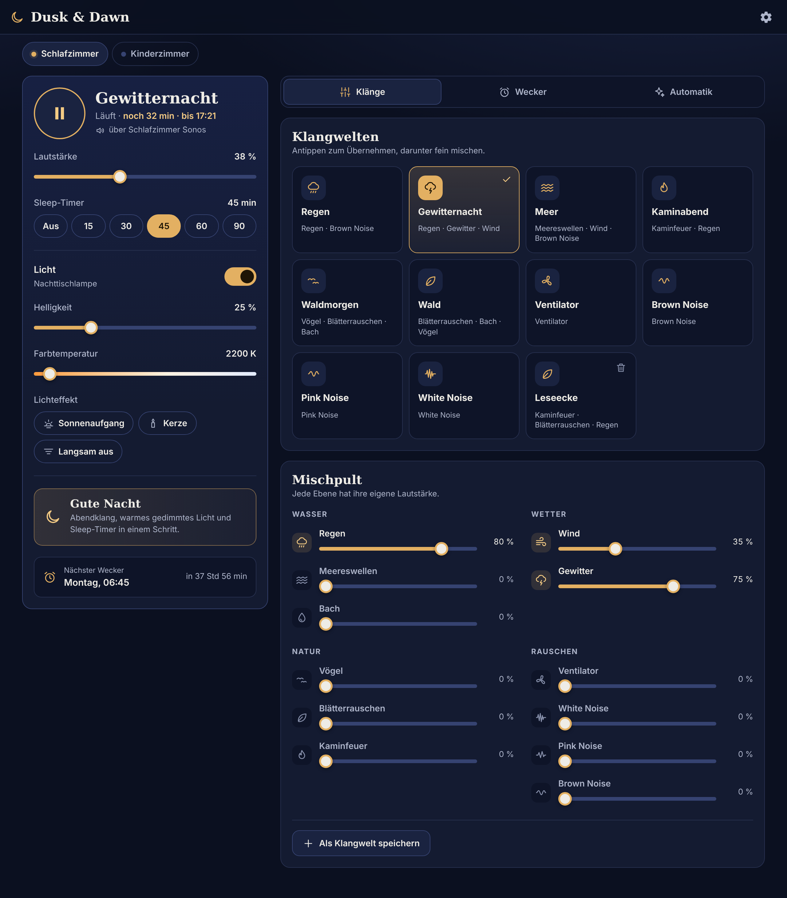

# Dusk & Dawn – Home-Assistant-Integration

Dusk & Dawn bringt die Schlafgeräusche, das Aufwachlicht und den Wecker der Soundlampe als normale Integration in Home Assistant. Sie läuft mit **jedem Lautsprecher**, der in HA als Media Player auftaucht (Sonos, Google/Nest, Music Assistant, Squeezebox …), und **jeder Lampe**. Die DIY-Soundlampe ist dabei nur ein mögliches Gerät unter vielen. Helfer, Automationen oder YAML braucht man nicht mehr.

## Installation über HACS

1. HACS öffnen → oben rechts ⋮ → **Benutzerdefinierte Repositories** → `https://github.com/PXLJAKE/SleepGenerator`, Typ **Integration**.
2. „Dusk & Dawn“ suchen, **Herunterladen**, Home Assistant neu starten.
3. **Einstellungen → Geräte & Dienste → Integration hinzufügen → Dusk & Dawn**.
4. Einen Schlafplatz anlegen: Name, Lautsprecher, Lampen und (optional) Präsenzmelder auswählen. Für weitere Zimmer einfach noch einmal hinzufügen.

Danach erscheint links in der Seitenleiste **Dusk & Dawn**.

## Bedienung

- **Jetzt:** Start/Stopp, Lautstärke, Sleep-Timer, Licht, „Gute Nacht“ (Klang, gedimmtes Licht und Timer in einem Schritt).
- **Klänge:** Klangwelten antippen oder im Mischpult jede der 12 Ebenen einzeln einstellen und als eigene Klangwelt speichern.
- **Wecker:** beliebig viele Weckzeiten mit Wochentagen, Weckton (Glocken, Klassisch, Vogelchor) mit Vorhören, Dauer, Lautstärke und Sonnenaufgang davor.
- **Automatik:** Start bei Anwesenheit im Zeitfenster, Aus wenn niemand mehr da ist, Pause bei Musik.
- **Zahnrad:** Lautsprecher, Lampen und Melder ändern.

Für eigene Automationen gibt es pro Schlafplatz Entitäten (Schalter, Klangwelt, Lautstärke, Timer, nächster Wecker …) und die Aktionen `dusk_dawn.play`, `stop`, `good_night`, `ring` und `stop_alarm`.

## Wie der Klang zum Lautsprecher kommt

Die Integration berechnet die Geräusche selbst und stellt sie als MP3-Stream bereit, den der Lautsprecher wie ein Internetradio abspielt. Dadurch reagieren Sonos und Google-Lautsprecher auf Regler mit 2–10 s Verzögerung. Die DIY-Soundlampe bekommt stattdessen nur Befehle über MQTT und rechnet den Klang selbst, ohne Verzögerung und mit Wecker auch ohne WLAN.

Der Klangkern ist in Rust geschrieben (`core/`) und braucht für vier Klänge etwa 0,5 % eines CPU-Kerns. Solange das Rust-Paket noch nicht auf PyPI liegt, nutzt die Integration automatisch die etwas langsamere Python-Version mit gleichem Klang.

## Grenzen

- Echo/Alexa-Lautsprecher spielen keine eigenen Streams ab.
- Kerzenflackern läuft auf normalen Lampen nur als sanftes Schwanken (max. 1 Befehl pro Sekunde), damit das Zigbee-Netz nicht überlastet.
- Nach einem HA-Neustart laufen die Geräusche nicht automatisch weiter.

## Entwicklung

- Tests: `python -m pytest tests` (braucht `pytest-homeassistant-custom-component`, siehe `tests/requirements_test.txt`), Klangkern: `cd core && cargo test`.
- Vorschau der Seitenleiste ohne HA: `custom_components/dusk_dawn/frontend/dev.html` im Browser öffnen.
- Schnittstellen zwischen Kern, Integration und Seitenleiste: [integration/CONTRACT.md](../integration/CONTRACT.md).
