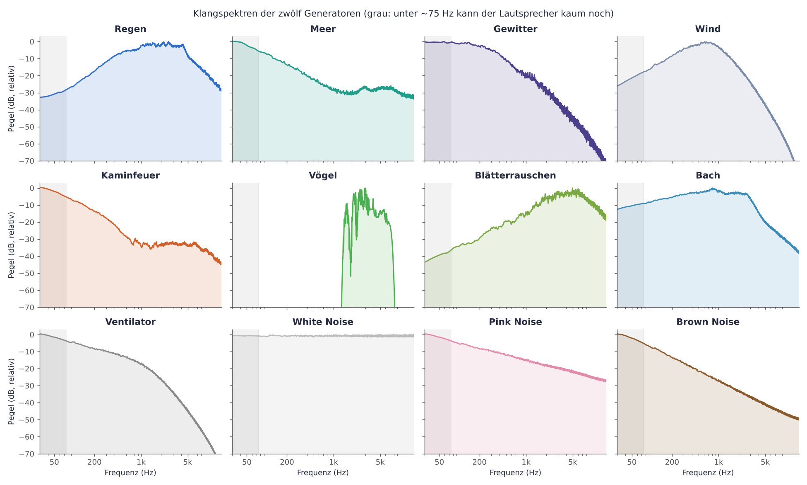

# Sound-Design

Die Soundlampe spielt keine Aufnahmen ab. Jeder Klang wird live auf dem Raspberry Pi berechnet (Code: [`hardware/device/sleepgen/dsp.py`](../hardware/device/sleepgen/dsp.py), Mischpult: [`engine.py`](../hardware/device/sleepgen/engine.py)). Das hat drei Vorteile:

- **Keine Schleife.** Eine Aufnahme wiederholt sich irgendwann, und das Ohr findet die Stelle. Ein berechneter Klang wiederholt sich nie.
- **Alles ist einstellbar.** Jede Ebene hat ihren eigenen Regler und lässt sich mit allen anderen mischen.
- **Keine Lizenzfragen**, kein Speicherplatz. Eigene WAV-Dateien gehen trotzdem (`file:/pfad/zur/datei.wav` in der Config, nahtlos überblendet).

Hörproben aller Klänge und Presets liegen als MP3 im Projektordner `soundlampe/hoerproben/` und lassen sich jederzeit neu erzeugen: `python -m sleepgen --render demo.wav --preset Gewitternacht`.

## Bausteine

Fast jeder Naturklang besteht aus zwei Teilen:

1. **Ein Teppich aus Rauschen**, der den Raum füllt. Rauschen wird mit Filtern geformt: Ein Tiefpass macht es dumpf und weich, ein Hochpass zischend, ein Bandpass lässt nur einen Bereich durch. Langsame Zufallskurven (`SmoothRandom`) bewegen Lautstärke und Filter, damit nichts statisch klingt.
2. **Viele kurze Ereignisse**, an denen das Ohr den Klang erkennt: ein einzelner Tropfen, ein Knacken im Holz, eine Luftblase. Diese „Körner“ (Klasse `Grains`) werden vorab als kleine Klangbausteine erzeugt, jedes Mal leicht anders, und dann zufällig über die Zeit, die Lautstärke und das Stereobild verstreut. Ein Teil der Körner ist deutlich lauter als der Rest (Pareto-Verteilung). Das klingt nach Nähe: die meisten Tropfen fallen irgendwo, einer fällt direkt neben dir.

Drei Arten von Körnern kommen immer wieder vor:

| Korn | Wie es entsteht | Wofür |
|---|---|---|
| **Plip** | kurzer Sinuston, dessen Tonhöhe *nach oben* gleitet, schnell abklingend, mit winzigem Klick am Anfang | Wassertropfen, Luftblasen, Schaum. Das Hochgleiten ist das, was Wasser nach Wasser klingen lässt: eine Luftblase im Wasser schwingt kurz und wird dabei kleiner |
| **Tick** | Rauschstoß von 0,2 bis 12 ms, durch einen Bandpass | Prasseln auf Blättern, Knistern im Feuer, Knall eines Holzscheits |
| **Blatt** | weiches Rauschschnipsel von 4 bis 35 ms, hell gefiltert | Blätterrauschen |

*So verteilt sich die Energie der zwölf Klänge auf die Frequenzen. Der graue Streifen links ist der Bereich unter etwa 75 Hz, den ein 4"-Lautsprecher kaum noch abstrahlt. Donner und Meer haben einen Teil ihrer Energie dort.*

## Die Klänge im Einzelnen

### Regen
*Wieder die ursprüngliche Version.*
- **Teppich:** rosa Rauschen zwischen 500 Hz und 7 kHz, das gleichmäßige Rauschen des Regens.
- **Tropfen:** etwa 900 einzelne Einschläge pro Sekunde und Kanal, unterschiedlich stark (Pareto-Verteilung), durch einen Bandpass bei 2,8 kHz. Das ergibt das feine, dichte Prasseln.
- Die Stärke schwankt langsam (etwa ±20 % über einige Sekunden), wie echte Schauer.

### Meer
*Wieder die ursprüngliche Version.*
- Rosa und braunes Rauschen laufen durch einen Tiefpass, der mit jeder Welle auf- und wieder zugeht (300 Hz bis 3,8 kHz).
- **Anrollen (2,5–4 s):** Lautstärke und Helligkeit wachsen, bis die Welle bricht.
- **Auslaufen (4–7 s):** Die Welle wird schnell leiser und dumpfer, danach bis zu 1,5 s Ruhe auf leisem Grundpegel.
- Jede Welle ist anders groß; eine langsame Stereobewegung lässt die Brandung durch den Raum rollen.

### Gewitter
*Wieder die ursprüngliche Version.*
- **Grollen:** tiefes Rauschen unter 90–220 Hz, das 6–13 s lang ausrollt, mit 2–4 Nachschwellungen.
- **Ferne Donner** setzen weich ein (0,6–1,8 s), **nahe** (30 %) plötzlich und mit einem leisen hellen Riss über 1,5 kHz.
- Ein Donner kommt alle 25–90 s (der erste nach spätestens 20 s) und kommt von links oder rechts.
- Lange Donner werden in einem eigenen Thread vorbereitet, damit der Pi beim Berechnen nicht stockt.
- Hinweis: Viel Energie liegt unter 80 Hz; auf einem kleinen Lautsprecher klingt der Donner deshalb leise und fern.

### Kaminfeuer (neu, 2026-11-21)
Die alte Version (Farnell, Practical 11) hatte ihre Energie fast nur unter 100 Hz, auf einem kleinen Lautsprecher war davon kaum etwas zu hören. Die neue Version hat vier Schichten, ihr Schwerpunkt liegt bei etwa 800 Hz:
- **Grollen:** rosa Rauschen zwischen 90 und 600 Hz, Pegel wandert (Periode 3,5 s) und flackert (0,45 s).
- **Zischen:** rosa Rauschen um 3 kHz, nur hörbar, wenn die Flammen hoch sind.
- **Knistern:** viele winzige helle Rauschstöße (0,7–3 ms, 1,5–7 kHz). Die Rate wandert (Periode 9 s) zwischen etwa 2 und 14 pro Sekunde, so entstehen Gruppen und Pausen.
- **Knacken:** seltene Stöße mit tiefem Körper (250–700 Hz) und Klick, etwa einer pro Sekunde in lebhaften Phasen.

### Vögel (neu, 2026-11-21)
Fünf feste „Individuen“ statt immer neuer Zufallsvögel. Jeder behält Tonhöhe und Rhythmus, singt seine Strophe ein- bis dreimal und wird nach etwa sechs Strophen durch einen neuen ersetzt, so verändert sich der Chor langsam. Die Dichte wandert zwischen „ein Vogel alle 20 s“ und „mehrere gleichzeitig“.

| Art | Aufbau |
|---|---|
| Zwitschern (Fink, Spatz) | 3–8 kurze, gleitende Töne bei 2,8–5,5 kHz |
| Triller (Zaunkönig, Rotkehlchen) | 12–24 Töne pro Sekunde |
| Pfiffe (Amsel) | 3–6 Melodietöne bei 1,5–3,6 kHz mit Vibrato und Obertönen |
| Kuckuck (7 % der Ereignisse, weit weg) | fallende kleine Terz („ku-kuu“, kurz hoch, lang tief), 3–7 Rufe, weicher Einsatz, Obertöne, leiser werdend |

40 % der Vögel sind weit weg: leiser und dumpfer durch einen Tiefpass.

### Blätterrauschen (neu)
- Langsame Windböen (Periode etwa 2,6 s) steuern, wie viel los ist: in Ruhe 60, in einer Böe bis 2 600 Blatt-Körner pro Sekunde.
- Dazu ein helles Rauschen über 2,2 kHz, das mit der Böe anschwillt.

### Bach (neu)
- Gluckernder Teppich: rosa Rauschen um 900 Hz, das sehr schnell schwankt (alle 0,15 s).
- Etwa 70 Luftblasen pro Sekunde (Plips 0,5–2,2 kHz, steil nach oben gleitend), dazu kleine Spritzer.

### Wind, Ventilator, White, Pink, Brown Noise
*Wie in der ursprünglichen Version.*
- **Wind:** Rauschen durch einen Bandpass, dessen Frequenz (250–900 Hz) und Lautstärke langsam wandern.
- **Ventilator:** rosa Rauschen unter 1,4 kHz, ganz leicht pulsierend (7,3 Hz, wie Rotorblätter), mit leisem Brummen bei 98 Hz.
- **White Noise:** alle Frequenzen gleich laut. Klingt hell.
- **Pink Noise:** −3 dB pro Oktave. Klingt ausgeglichen, wie gleichmäßiger Regen.
- **Brown Noise:** −6 dB pro Oktave. Klingt tief und weich, wie ein Wasserfall in der Ferne. Viele schlafen damit am besten.

## Presets

| Preset | Mischung |
|---|---|
| Regen | Regen 80 %, Brown 30 % |
| Gewitternacht | Regen 80 %, Gewitter 75 %, Wind 35 % |
| Meer | Meer 85 %, Wind 25 %, Brown 20 % |
| Kaminabend | Feuer 80 %, Regen 40 % |
| Waldmorgen | Vögel 65 %, Blätter 45 %, Bach 30 %, Wind 15 % |
| Wald | Blätter 60 %, Bach 50 %, Vögel 30 % |
| Ventilator / Brown / Pink / White Noise | jeweils allein |

Eigene Presets kommen in `/etc/sleepgen/config.yaml` unter `presets:`. Wer einen Regler im Dashboard ändert, bekommt im Preset-Feld „Eigene Mischung“ angezeigt.

## Das Mischpult

- **Pegel:** Jeder Generator ist auf etwa −18 dBFS RMS kalibriert. So ist „50 %“ bei Regen ungefähr so laut wie „50 %“ bei Meer.
- **Lautstärkekurve:** Regler arbeiten nicht linear, sondern so, wie das Ohr hört (etwa 40 dB Umfang). Die untere Hälfte des Reglers ist für leises Einschlafen gut nutzbar.
- **Weiche Übergänge:** Jede Reglerbewegung wird über 80 ms geglättet, Start und Stopp über 8 s bzw. 2 s ausgeblendet. Es knackt nie.
- **Sleep-Timer:** In den letzten 10 Minuten wird leiser, erst kaum merklich, dann schneller (Kurve x^2,5). So gibt es keinen Moment, in dem der Klang plötzlich fehlt und man aufwacht.
- **Limiter:** Ein weicher Begrenzer (tanh) verhindert Übersteuern, auch wenn alle Regler auf 100 % stehen. Unterhalb von etwa −6 dBFS greift er nicht ein.
- **Zwei Lautstärken:** „Lautstärke Sounds“ mischt nur die Geräusche. „Gerätelautstärke“ (= Drehknopf) stellt den Verstärker und wirkt auch auf Musik.

## Wecker

Der Wecker läuft im Gerät selbst und spielt immer, egal ob gerade Sounds laufen:

- **Töne:** Glocken (sanftes Glockenspiel-Arpeggio C-E-G-C), Klassisch (Doppelpiepen) oder Vogelchor (dichter, lauter Morgenchor).
- **Wird lauter:** Er beginnt bei 15 % und wird in 40 s auf die eingestellte Wecklautstärke hochgefahren.
- **Hört auf** nach der eingestellten Weckdauer (1–60 min, Standard 10) oder sofort beim **Druck auf den Drehknopf**. Solange der Wecker klingelt, stoppt ein Druck nur den Wecker und schaltet nicht die Sounds um.
- **Nicht zu leise:** Steht der Verstärker nachts auf leise, hebt die Lampe ihn beim Klingeln auf mindestens 50 % an und stellt danach den alten Wert wieder her.
- **In Home Assistant:** Zur Weckzeit startet die Automation „Soundlampe – Wecker klingelt“ den Wecker. Das passiert nur, wenn „Wecker klingelt zur Weckzeit“ an ist, auf Wunsch nur werktags. Mit dem Aufwachlicht zusammen wird es zuerst hell und klingelt dann.

## CPU-Last

Auf einem PC braucht der Regen allein etwa 2 % eines Kerns. Auf dem Pi 3 A+ rechne ich grob mit dem Zehnfachen, also 20–50 % eines Kerns für ein Preset mit 2–3 Ebenen (geschätzt, auf dem Pi noch nicht gemessen). Ebenen auf 0 % werden gar nicht berechnet. Blätterrauschen und Bach kalibrieren beim Start einmal ihren Pegel, das dauert auf dem Pi ein paar Sekunden.

Der Python-Ersatz in Home Assistant (ohne scipy) rechnet dieselben Filter exakt, aber blockweise mit numpy. Vier Klänge gleichzeitig (Regen, Meer, Wind, Feuer) brauchen dort auf einem PC etwa 13 % eines Kerns.
