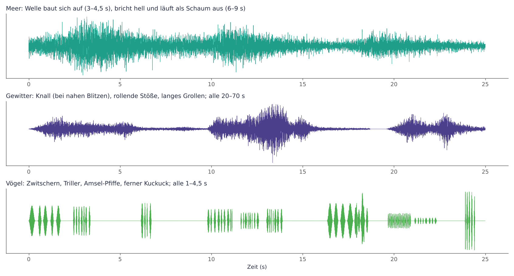

# Sound-Design

Die eingebauten Klänge sind keine Aufnahmen. Jeder wird live berechnet: **in Home Assistant** vom Klangkern in Rust (Code: [`core/`](../core/), mit Python-Ersatz in `custom_components/dusk_dawn/engine/`) und, bei der optionalen DIY-Soundlampe, **auf dem Raspberry Pi** (Code: [`hardware/device/sleepgen/dsp.py`](../hardware/device/sleepgen/dsp.py), Mischpult: [`engine.py`](../hardware/device/sleepgen/engine.py)). Beide rechnen dieselben Klänge. Das hat drei Vorteile:

- **Keine Schleife.** Eine Aufnahme wiederholt sich irgendwann, und das Ohr findet die Stelle. Ein berechneter Klang wiederholt sich nie.
- **Alles ist einstellbar.** Jede Ebene hat ihren eigenen Regler und lässt sich mit allen anderen mischen.
- **Keine Lizenzfragen**, kein Speicherplatz. Eigene Aufnahmen gehen trotzdem, siehe [EIGENE_AUFNAHMEN.md](EIGENE_AUFNAHMEN.md). Natürliche Klänge wie Feuer, Vögel oder Bach sind als eingebaute Klänge entfernt; wer sie will, lädt eine eigene Aufnahme hoch.

Hörproben lassen sich mit der Pi-Software erzeugen: `python -m sleepgen --render demo.wav --preset Gewitternacht`.

## Bausteine

Die Klänge bestehen aus zwei Teilen:

1. **Ein Teppich aus Rauschen**, der den Raum füllt. Rauschen wird mit Filtern geformt: Ein Tiefpass macht es dumpf und weich, ein Hochpass zischend, ein Bandpass lässt nur einen Bereich durch. Langsame Zufallskurven (`SmoothRandom`) bewegen Lautstärke und Filter, damit nichts statisch klingt.
2. **Viele kurze Ereignisse**, an denen das Ohr den Klang erkennt: ein einzelner Tropfen, ein Knacken im Holz, eine Luftblase. Diese „Körner“ (Klasse `Grains`) werden vorab als kleine Klangbausteine erzeugt, jedes Mal leicht anders, und dann zufällig über die Zeit, die Lautstärke und das Stereobild verstreut. Ein Teil der Körner ist deutlich lauter als der Rest (Pareto-Verteilung). Das klingt nach Nähe: die meisten Tropfen fallen irgendwo, einer fällt direkt neben dir.

Zwei Arten von Körnern kommen vor:

| Korn | Wie es entsteht | Wofür |
|---|---|---|
| **Plip** | kurzer Sinuston, dessen Tonhöhe *nach oben* gleitet, schnell abklingend, mit winzigem Klick am Anfang | Wassertropfen, Luftblasen, Schaum. Das Hochgleiten ist das, was Wasser nach Wasser klingen lässt: eine Luftblase im Wasser schwingt kurz und wird dabei kleiner |
| **Tick** | Rauschstoß von 0,2 bis 12 ms, durch einen Bandpass | feines Prasseln |

*So verteilt sich die Energie der Klänge (das Bild zeigt auch Klänge, die inzwischen nicht mehr eingebaut sind) auf die Frequenzen. Der graue Streifen links ist der Bereich unter etwa 75 Hz, den ein 4"-Lautsprecher kaum noch abstrahlt. Donner und Meer haben einen Teil ihrer Energie dort.*

## Die Klänge im Einzelnen

### Regen
- **Teppich:** rosa Rauschen zwischen 500 Hz und 7 kHz, das gleichmäßige Rauschen des Regens.
- **Tropfen:** etwa 900 einzelne Einschläge pro Sekunde und Kanal, unterschiedlich stark (Pareto-Verteilung), durch einen Bandpass bei 2,8 kHz. Das ergibt das feine, dichte Prasseln.
- Die Stärke schwankt langsam (etwa ±20 % über einige Sekunden), wie echte Schauer.

### Meer
- Rosa und braunes Rauschen laufen durch einen Tiefpass, der mit jeder Welle auf- und wieder zugeht (300 Hz bis 3,8 kHz).
- **Anrollen (2,5–4 s):** Lautstärke und Helligkeit wachsen, bis die Welle bricht.
- **Auslaufen (4–7 s):** Die Welle wird schnell leiser und dumpfer, danach bis zu 1,5 s Ruhe auf leisem Grundpegel.
- Jede Welle ist anders groß; eine langsame Stereobewegung lässt die Brandung durch den Raum rollen.

### Gewitter
- **Grollen:** tiefes Rauschen unter 90–220 Hz, das 6–13 s lang ausrollt, mit 2–4 Nachschwellungen.
- **Ferne Donner** setzen weich ein (0,6–1,8 s), **nahe** (30 %) plötzlich und mit einem leisen hellen Riss über 1,5 kHz.
- Ein Donner kommt alle 25–90 s (der erste nach spätestens 20 s) und kommt von links oder rechts.
- Lange Donner werden in kleinen Stücken vorbereitet, damit beim Berechnen nichts stockt.
- Hinweis: Viel Energie liegt unter 80 Hz; auf einem kleinen Lautsprecher klingt der Donner deshalb leise und fern.

### Wind, Ventilator, White, Pink, Brown Noise
- **Wind:** Rauschen durch einen Bandpass, dessen Frequenz (250–900 Hz) und Lautstärke langsam wandern.
- **Ventilator:** rosa Rauschen unter 1,4 kHz, ganz leicht pulsierend (7,3 Hz, wie Rotorblätter), mit leisem Brummen bei 98 Hz.
- **White Noise:** alle Frequenzen gleich laut. Klingt hell.
- **Pink Noise:** −3 dB pro Oktave. Klingt ausgeglichen, wie gleichmäßiger Regen.
- **Brown Noise:** −6 dB pro Oktave. Klingt tief und weich, wie ein Wasserfall in der Ferne. Viele schlafen damit am besten.

## Presets

| Klangwelt | Mischung |
|---|---|
| Regen | Regen 80 %, Brown 30 % |
| Gewitternacht | Regen 80 %, Gewitter 75 %, Wind 35 % |
| Meer | Meer 85 %, Wind 25 %, Brown 20 % |
| Ventilator / Brown / Pink / White Noise | jeweils allein |

Eigene Klangwelten legst du in der Seitenleiste an (Mischpult einstellen, speichern, benennen); sie können auch eigene Klänge enthalten. Auf der DIY-Lampe stehen eigene Presets in `/etc/sleepgen/config.yaml` unter `presets:`.

## Das Mischpult

- **Pegel:** Jeder Generator ist auf etwa −18 dBFS RMS kalibriert. So ist „50 %“ bei Regen ungefähr so laut wie „50 %“ bei Meer.
- **Lautstärkekurve:** Regler arbeiten nicht linear, sondern so, wie das Ohr hört (rund 48 dB Umfang). Ganz oben sind die Klänge absichtlich leiser als Musik, die untere Hälfte des Reglers ist für leises Einschlafen gut nutzbar.
- **Weiche Übergänge:** Jede Reglerbewegung wird über 80 ms geglättet, Start und Stopp über 8 s bzw. 2 s ausgeblendet. Es knackt nie.
- **Sleep-Timer:** In den letzten 10 Minuten wird leiser, erst kaum merklich, dann schneller (Kurve x^2,5). So gibt es keinen Moment, in dem der Klang plötzlich fehlt und man aufwacht.
- **Limiter:** Ein weicher Begrenzer (tanh) verhindert Übersteuern, auch wenn alle Regler auf 100 % stehen. Unterhalb von etwa −6 dBFS greift er nicht ein.
- **Zwei Lautstärken:** „Lautstärke Sounds“ mischt nur die Geräusche. „Gerätelautstärke“ (= Drehknopf) stellt den Verstärker und wirkt auch auf Musik.

## Wecker

Auf der DIY-Lampe läuft der Wecker im Gerät selbst und spielt immer, auch ohne Home Assistant und ohne WLAN. Mit normalen Lautsprechern startet Home Assistant ihn zur Weckzeit.

- **Töne:** Glocken (sanftes Glockenspiel-Arpeggio C-E-G-C), Klassisch (Doppelpiepen) oder Vogelchor (dichter Morgenchor).
- **Wird lauter:** Er beginnt leise und wird in 40 s auf die eingestellte Wecklautstärke hochgefahren. Die Wecklautstärke ist halbiert gegenüber der Reglerskala, 5 % ist schon deutlich hörbar.
- **Hört auf** nach der eingestellten Weckdauer (Standard 10 Minuten) oder sofort auf Knopfdruck (Soundlampe: Drehknopf, sonst Seitenleiste).
- **Nicht zu leise:** Steht der Verstärker der Lampe nachts auf leise, hebt sie ihn beim Klingeln an und stellt danach den alten Wert wieder her.
- **Mit Sonnenaufgang:** Zuerst wird es hell, zur Weckzeit klingelt es.

## CPU-Last

Der Rust-Kern in Home Assistant braucht für vier Klänge etwa 0,5 % eines CPU-Kerns. Der Python-Ersatz (ohne Rust-Modul) rechnet dieselben Filter blockweise mit numpy, vier Klänge brauchen dort auf einem PC etwa 13 % eines Kerns. Auf dem Pi 3 A+ der DIY-Lampe ist die Last deutlich höher, deshalb arbeitet sie mit einem Vorrechenpuffer; Ebenen auf 0 % werden gar nicht berechnet.
