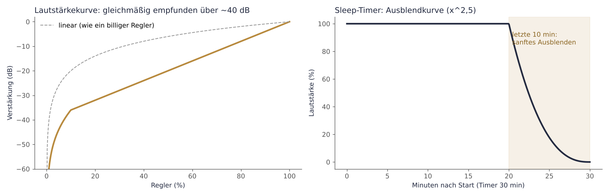

# Sound-Design

Die Soundlampe spielt keine Aufnahmen ab. Jeder Klang wird live auf dem Raspberry Pi berechnet (Code: [`device/sleepgen/dsp.py`](../device/sleepgen/dsp.py), Mischpult: [`engine.py`](../device/sleepgen/engine.py)). Das hat drei Vorteile:

- **Keine Schleife.** Eine Aufnahme wiederholt sich irgendwann, und das Ohr findet die Stelle. Ein berechneter Klang wiederholt sich nie.
- **Alles ist einstellbar.** Jede Ebene hat ihren eigenen Regler und lässt sich mit allen anderen mischen.
- **Keine Lizenzfragen**, kein Speicherplatz. Eigene WAV-Dateien gehen trotzdem (`file:/pfad/zur/datei.wav` in der Config, nahtlos überblendet).

Hörproben aller Klänge und Presets liegen als MP3 im Projektordner `soundlampe/hoerproben/` und lassen sich jederzeit neu erzeugen: `python -m sleepgen --render demo.wav --preset Gewitternacht`.

## Bausteine

Fast jeder Naturklang besteht aus zwei Teilen:

1. **Ein Teppich aus Rauschen**, der den Raum füllt. Rauschen wird mit Filtern geformt: Ein Tiefpass macht es dumpf und weich, ein Hochpass zischend, ein Bandpass lässt nur einen Bereich durch. Langsame Zufallskurven (`SmoothRandom`) bewegen Lautstärke und Filter, damit nichts statisch klingt.
2. **Viele kurze Ereignisse**, an denen das Ohr den Klang erkennt: ein einzelner Tropfen, ein Knacken im Holz, eine Luftblase. Diese „Körner“ (Klasse `Grains`) werden vorab als kleine Klangbausteine erzeugt, jedes Mal leicht anders, und dann zufällig über die Zeit, die Lautstärke und das Stereobild verstreut. Ein Teil der Körner ist deutlich lauter als der Rest (Pareto-Verteilung). Das klingt nach Nähe: die meisten Tropfen fallen irgendwo, einer fällt direkt neben dir.

Drei Arten von Körnern kommen immer wieder vor:

| Korn | Wie es entsteht | Wofür |
|---|---|---|
| **Plip** | kurzer Sinuston, dessen Tonhöhe *nach oben* gleitet, schnell abklingend, mit winzigem Klick am Anfang | Wassertropfen, Luftblasen, Schaum. Das Hochgleiten ist das, was Wasser nach Wasser klingen lässt: eine Luftblase im Wasser schwingt kurz und wird dabei kleiner |
| **Tick** | Rauschstoß von 0,2 bis 12 ms, durch einen Bandpass | Prasseln auf Blättern, Knistern im Feuer, Knall eines Holzscheits |
| **Blatt** | weiches Rauschschnipsel von 4 bis 35 ms, hell gefiltert | Blätterrauschen |

*So verteilt sich die Energie der zwölf Klänge auf die Frequenzen. Der graue Streifen links ist der Bereich unter etwa 75 Hz, den ein 4"-Lautsprecher kaum noch abstrahlt. Deshalb sind Donner und Wellen bewusst so gestimmt, dass ihr Charakter darüber liegt.*

## Die Klänge im Einzelnen

### Regen
- **Teppich:** rosa Rauschen zwischen 600 Hz und 6,5 kHz. Das ist das gleichmäßige Rauschen von Regen in der Ferne.
- **Prasseln:** etwa 1 400 winzige Ticks pro Sekunde (2,5–7 kHz). Das ist der Regen auf Blättern, Dach und Fenster.
- **Deutliche Tropfen:** etwa 22 Plips pro Sekunde (1,4–4,2 kHz, 12–35 ms), einige davon deutlich lauter. Das sind Tropfen in Pfützen und Regenrinnen.
- **Dicke Tropfen:** etwa 2–3 pro Sekunde, tiefer (0,7–1,5 kHz) und länger. Sie tropfen von der Dachkante oder von Ästen in der Nähe.
- Die Stärke schwankt langsam (±20 % über einige Sekunden), wie echte Schauer.

### Meer
Jede Welle ist ein eigenes Ereignis mit drei Hüllkurven. Wellen überlappen sich, sind unterschiedlich groß und sitzen an verschiedenen Stellen im Stereobild.

1. **Anrollen (3–4,5 s):** Tiefes, braunes Rauschen (unter 380 Hz) schwillt an. Das ist der Wasserkörper.
2. **Kamm und Brechen:** In den letzten 1,3 s vor dem Brechen wächst ein Zischen. Beim Brechen öffnet ein Tiefpass von 500 Hz bis 7,5 kHz, also hell und breit. Danach klingt er in etwa 1–1,5 s ab.
3. **Auslaufen (6–9 s):** Schaum und Rückströmung. Ein leises Zischen bleibt, dazu bis zu 900 kleine Plips pro Sekunde (2–6,5 kHz). Das sind die platzenden Bläschen im Schaum. Dieses Knistern im Auslaufen hat der alten Version gefehlt.
4. **Darunter:** Ein ruhiger Brandungsteppich (rosa Rauschen unter 650 Hz) bleibt ständig leise da, damit zwischen den Wellen keine Stille entsteht.

Alle 5–9,5 s beginnt die nächste Welle, die vorige läuft noch aus.

### Gewitter
Echter Donner hat den Großteil seiner Energie unter 80 Hz. Genau dort kann ein kleiner Lautsprecher nichts mehr abstrahlen. Deshalb ist der Donner für die Lampe neu gestimmt:

- **Grollen** zwischen etwa 120 und 500 Hz statt unter 200 Hz, mit 3–5 Nachschwellungen. Dieser Bereich ist laut genug für den Lautsprecher.
- **Rollen:** 4–9 kurze Stöße im Bereich 180–1 400 Hz in den ersten 3,5 Sekunden. Das ist das typische „Krrr-wumm-wumm“.
- **Knall:** Bei 45 % der Blitze (nahe Einschläge) gibt es einen hellen Riss mit Echo nach 0,18 s.
- Ein Donner kommt alle 20–70 s, ist 7–14 s lang und kommt von links oder rechts.
- Lange Donner werden in einem eigenen Thread vorbereitet, damit der Pi beim Berechnen nicht stockt.

### Kaminfeuer
- **Grundrauschen:** braunes Rauschen unter 420 Hz für das Brennen der Flammen, dazu ein feines Zischen über 3 kHz.
- **Einzelnes Knistern:** etwa 45 Ticks pro Sekunde (1,8–6,5 kHz, 0,2–1,2 ms), ab und zu ein lauter.
- **Knister-Salven:** etwa 2 pro Sekunde, jeweils 3–11 Ticks in 30–180 ms. Das ist das „tsk-tsk-tsk“ von Harz und Feuchtigkeit im Holz, an dem man Feuer sofort erkennt.
- **Knacken:** alle 3 s ein tieferer Knall (500–1 400 Hz) von einem Scheit, der springt.
- Die Aktivität schwankt: mal brennt es ruhig, mal knistert es viel.
- Gegenüber der ersten Version ist das Knistern etwa 18 dB lauter im Verhältnis zum Grundrauschen.

### Vögel
Ein Morgenchor aus mehreren „Arten“, alle 1–4,5 s eine neue Strophe:

| Art | Aufbau | Anteil |
|---|---|---|
| Zwitschern (Fink, Spatz) | 3–9 kurze, gleitende Töne bei 2,8–5,5 kHz | 42 % |
| Triller (Zaunkönig, Rotkehlchen) | 12–24 Töne pro Sekunde, 0,6–1,6 s lang | 25 % |
| Pfiffe (Amsel) | 3–6 langsame Melodietöne bei 1,7–3,4 kHz mit Vibrato | 28 % |
| Kuckuck | zwei tiefe Töne, weit weg | 5 % |

40 % der Vögel sind weit weg: Sie sind leiser und dumpfer, weil ein Tiefpass die Höhen nimmt, wie in echt.

### Blätterrauschen (neu)
- Langsame Windböen (Periode etwa 2,6 s) steuern, wie viel los ist: in Ruhe 60, in einer Böe bis 2 600 Blatt-Körner pro Sekunde.
- Dazu ein helles Rauschen über 2,2 kHz, das mit der Böe anschwillt.

### Bach (neu)
- Gluckernder Teppich: rosa Rauschen um 900 Hz, das sehr schnell schwankt (alle 0,15 s).
- Etwa 70 Luftblasen pro Sekunde (Plips 0,5–2,2 kHz, steil nach oben gleitend), dazu kleine Spritzer.

### Wind, Ventilator, White, Pink, Brown Noise
- **Wind:** Rauschen durch einen Bandpass, dessen Frequenz (250–900 Hz) und Lautstärke langsam wandern.
- **Ventilator:** rosa Rauschen unter 1,4 kHz, ganz leicht pulsierend (7,3 Hz, wie Rotorblätter), mit leisem Brummen bei 98 Hz.
- **White Noise:** alle Frequenzen gleich laut. Klingt hell.
- **Pink Noise:** −3 dB pro Oktave. Klingt ausgeglichen, wie gleichmäßiger Regen.
- **Brown Noise:** −6 dB pro Oktave. Klingt tief und weich, wie ein Wasserfall in der Ferne. Viele schlafen damit am besten.

## Presets

| Preset | Mischung |
|---|---|
| Regen | Regen 80 %, Brown 30 % |
| Gewitternacht | Regen 80 %, Gewitter 75 %, Wind 35 % |
| Meer | Meer 85 %, Wind 25 %, Brown 20 % |
| Kaminabend | Feuer 80 %, Regen 40 % |
| Waldmorgen | Vögel 65 %, Blätter 45 %, Bach 30 %, Wind 15 % |
| Wald | Blätter 60 %, Bach 50 %, Vögel 30 % |
| Ventilator / Brown / Pink / White Noise | jeweils allein |

Eigene Presets kommen in `/etc/sleepgen/config.yaml` unter `presets:`. Wer einen Regler im Dashboard ändert, bekommt im Preset-Feld „Eigene Mischung“ angezeigt.

## Das Mischpult

- **Pegel:** Jeder Generator ist auf etwa −18 dBFS RMS kalibriert. So ist „50 %“ bei Regen ungefähr so laut wie „50 %“ bei Meer.
- **Lautstärkekurve:** Regler arbeiten nicht linear, sondern so, wie das Ohr hört (etwa 40 dB Umfang). Die untere Hälfte des Reglers ist für leises Einschlafen gut nutzbar.
- **Weiche Übergänge:** Jede Reglerbewegung wird über 80 ms geglättet, Start und Stopp über 8 s bzw. 2 s ausgeblendet. Es knackt nie.
- **Sleep-Timer:** In den letzten 10 Minuten wird leiser, erst kaum merklich, dann schneller (Kurve x^2,5). So gibt es keinen Moment, in dem der Klang plötzlich fehlt und man aufwacht.
- **Limiter:** Ein weicher Begrenzer (tanh) verhindert Übersteuern, auch wenn alle Regler auf 100 % stehen. Unterhalb von etwa −6 dBFS greift er nicht ein.
- **Zwei Lautstärken:** „Lautstärke Sounds“ mischt nur die Geräusche. „Gerätelautstärke“ (= Drehknopf) stellt den Verstärker und wirkt auch auf Musik.

## Wecker

Der Wecker läuft im Gerät selbst und spielt immer, egal ob gerade Sounds laufen:

- **Töne:** Glocken (sanftes Glockenspiel-Arpeggio C-E-G-C), Klassisch (Doppelpiepen) oder Vogelchor (dichter, lauter Morgenchor).
- **Wird lauter:** Er beginnt bei 15 % und wird in 40 s auf die eingestellte Wecklautstärke hochgefahren.
- **Hört auf** nach der eingestellten Weckdauer (1–60 min, Standard 10) oder sofort beim **Druck auf den Drehknopf**. Solange der Wecker klingelt, stoppt ein Druck nur den Wecker und schaltet nicht die Sounds um.
- **Nicht zu leise:** Steht der Verstärker nachts auf leise, hebt die Lampe ihn beim Klingeln auf mindestens 50 % an und stellt danach den alten Wert wieder her.
- **In Home Assistant:** Zur Weckzeit startet die Automation „Soundlampe – Wecker klingelt“ den Wecker. Das passiert nur, wenn „Wecker klingelt zur Weckzeit“ an ist, auf Wunsch nur werktags. Mit dem Aufwachlicht zusammen wird es zuerst hell und klingelt dann.

## CPU-Last

Auf einem PC braucht der Regen allein etwa 2 % eines Kerns. Auf dem Pi 3 A+ rechne ich grob mit dem Zehnfachen, also 20–50 % eines Kerns für ein Preset mit 2–3 Ebenen (geschätzt, auf dem Pi noch nicht gemessen). Ebenen auf 0 % werden gar nicht berechnet. Beim Start kalibriert jeder Generator einmal seinen Pegel, das dauert auf dem Pi ein paar Sekunden.
