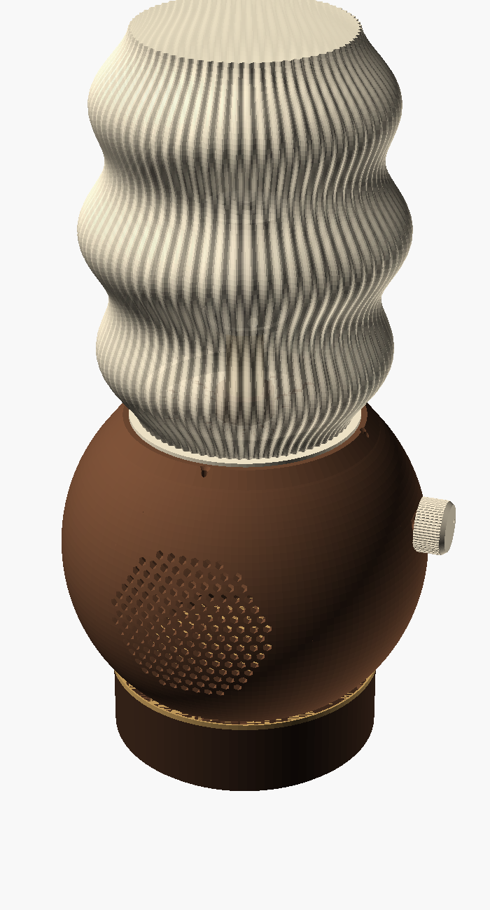
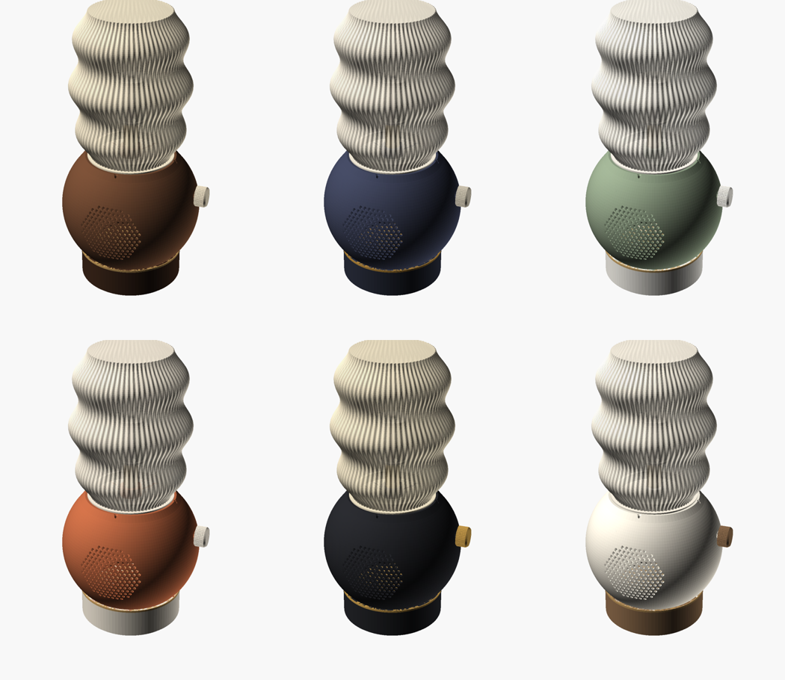
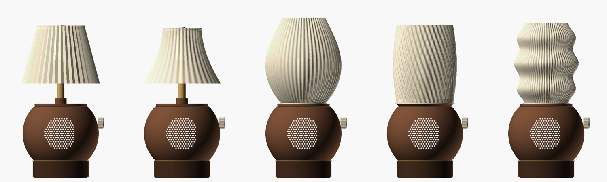
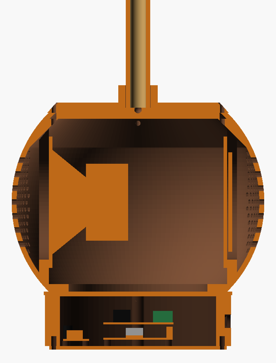
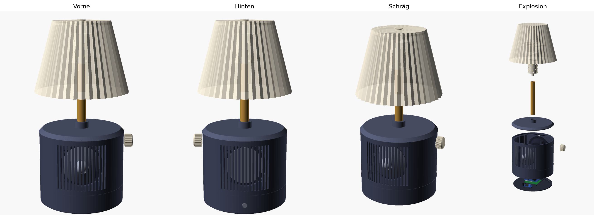

# Gehäuse: Retro-Soundlampe


Parametrisches OpenSCAD-Modell: [`soundlampe.scad`](soundlampe.scad). Fertige STL-Dateien liegen in [`stl/`](stl/). Als zweite Fuß-Version gibt es eine [Kugel](#zweite-fuß-version-kugel) (`soundlampe_kugel.scad`).

> **Welche Teile drucken?** Siehe [Was muss ich drucken?](#was-muss-ich-drucken): Teile für alle, Teile nur für Zylinder oder Kugel, Teile je Schirm.

- **Fuß (Ø 190 × 160 mm):** Unten ein Elektronikfach, darüber eine dichte Lautsprecherkammer mit ca. 2,4 l brutto (ca. 2,1 l netto nach Abzug von Chassis, Rippen und Kabelrohr, passend zum Vas von ca. 2 l des ND105-4). Vorne sitzt der 4"-Breitbänder, hinten die Passivmembran, beide hinter senkrechten Lamellen im Stil alter Röhrenradios. Das Kabelrohr läuft seitlich (45 mm neben der Mitte) durch die Kammer, weil der Magnet des ND105-4 bis über die Mitte reicht. Im Deckel führt ein Kanal vom Rohr zum Stiel.
- **Stiel:** Messingrohr 20 mm oder gedruckt. Das LED-Kabel läuft innen durch.
- **Lichtkern:** Eine Spule (Ø 40 mm), um die der SK6812-Strip spiralförmig gewickelt wird. 0,5 m ergeben 4 Windungen.
- **Schirm:** fünf Varianten zur Auswahl (Parameter `shade_style`), alle gerippt, als Hülle mit 1,2 mm Wand modelliert und ohne Stützen druckbar (Kugelschirme oben mit Lüftungslöchern, umgedreht gedruckt), siehe unten.
- **Drehknopf:** seitlich rechts am Fuß (`knob_pos = "side"`), damit er bei den Kugelschirmen nicht unter dem Glas verschwindet. `knob_pos = "top"` setzt ihn wie früher in den Deckel.
- **Gesamthöhe:** ca. 41 cm mit Plissee-Schirm, die Kugelschirme sind etwas niedriger

## Was muss ich drucken?

Die Lampe besteht aus drei Gruppen: Teile, die **immer** gebraucht werden, der **Fuß** (Zylinder **oder** Kugel) und der **Schirm** mit seinen Halteteilen. Alle Dateien liegen in [`stl/`](stl/).

### 1. Immer drucken (beide Fuß-Versionen)

| Teil | Datei | Anzahl |
|---|---|---|
| Lichtkern | `led_core.stl` | 1 |
| Drehknopf | `knob.stl` | 1 |

### 2. Fuß: eine Version wählen

| | **A: Zylinder** (`soundlampe.scad`) | **B: Kugel** (`soundlampe_kugel.scad`) |
|---|---|---|
| Gehäuse / Kammer | `base_shell.stl` | `kugel_sphere_shell.stl` |
| Boden der Kammer | `divider.stl` | im Sockel enthalten: `kugel_plinth.stl` |
| Deckel | je nach Schirm, siehe Tabelle 3 | je nach Schirm, siehe Tabelle 3 |
| Kabelrohr | `conduit.stl` | `kugel_sphere_conduit.stl` |
| Bodenplatte | `bottom_plate.stl` | `kugel_plinth_plate.stl` |
| Druckbett mindestens | 200 × 200 mm | 210 × 210 mm |

Die Fuß-Teile der beiden Versionen passen nicht untereinander. Alles aus Gruppe 1 und 3 passt auf beide.

### 3. Schirm: einen wählen

| Schirm | Schirm-Datei | Kerndeckel | Halteteil | Stiel (wenn kein Messingrohr) | Deckel Zylinder | Deckel Kugel |
|---|---|---|---|---|---|---|
| Plissee | `shade_plissee.stl` | `core_cap_plissee.stl` | `spider_plissee.stl` | Zylinder `stem.stl` (150 mm), Kugel `kugel_stem.stl` (122 mm) | `top_lid.stl` | `kugel_sphere_lid.stl` |
| Glocke | `shade_glocke.stl` | `core_cap_glocke.stl` | `spider_glocke.stl` | Zylinder `stem.stl` (150 mm), Kugel `kugel_stem.stl` (122 mm) | `top_lid.stl` | `kugel_sphere_lid.stl` |
| Kolben | `shade_kolben.stl` | `core_cap_globe.stl` | `globe_seat_kolben.stl` | `stem_short.stl` | `top_lid_kolben.stl` | `kugel_sphere_lid_kolben.stl` |
| Twist | `shade_twist.stl` | `core_cap_globe.stl` | `globe_seat_twist.stl` | `stem_short.stl` | `top_lid_twist.stl` | `kugel_sphere_lid_twist.stl` |
| Laterne | `shade_laterne.stl` | `core_cap_globe.stl` | `globe_seat_laterne.stl` | `stem_short.stl` | `top_lid_laterne.stl` | `kugel_sphere_lid_laterne.stl` |

Der Deckel hängt vom Schirm ab, weil Kolben, Twist und Laterne mit 3 Schrauben auf dem Deckel sitzen und jeder Schirm einen anderen Durchmesser hat.

**Beispiel Kugel mit Laterne:** `led_core`, `knob`, `kugel_sphere_shell`, `kugel_plinth`, `kugel_sphere_lid_laterne`, `kugel_sphere_conduit`, `kugel_plinth_plate`, `shade_laterne`, `core_cap_globe`, `globe_seat_laterne`, `stem_short`. Das sind 11 Teile.

Material und Druckeinstellungen je Teil stehen weiter unten ([Zylinder](#teile-und-druckeinstellungen), [Kugel](#zweite-fuß-version-kugel)).

## Zweite Fuß-Version: Kugel



Datei: [`soundlampe_kugel.scad`](soundlampe_kugel.scad). Der Zylinderfuß oben bleibt unverändert. Die Kugel ist eine Alternative mit denselben Lautsprechern, derselben Elektronik und allen Schirmen. Stiel, Lichtkern, Kerndeckel, Schirmsitz, Spinne, Knopf und Schirme kommen aus `soundlampe.scad`.

- **Form:** Kugel Ø 204 mm, oben und unten bei ±45° abgeschnitten, auf einem schlanken Sockel (Ø 150 × 44 mm) für die Elektronik. Höhe des Fußes 188 mm, mit Laterne ca. 41 cm.
- **Akustik:** ca. 3,1 l brutto bzw. 2,8 l netto, also mehr Volumen als der Zylinder (2,1 l netto). Das gibt etwas mehr Bass. Eine Kugel hat keine parallelen Wände (weniger stehende Wellen), beugt den Schall an den Kanten weich und ist bei 4 mm Wand sehr steif, deshalb braucht sie keine Rippen. Breitbänder vorne, Passivmembran hinten, beide hinter einem runden Lochfeld mit Sechskantlöchern.
- **Druck ohne Stützen:** Die Kugelschale druckt aufrecht, die untere Hälfte neigt sich höchstens 45° nach außen. Der Sockel druckt auf dem Kopf, Deckel und Bodenplatte flach. Druckbett mindestens 210 × 210 mm.
- **Farbthemen:** Parameter `theme` nur für die Bilder (`walnuss`, `nachtblau`, `salbei`, `terrakotta`, `schwarz`, `creme`). Gedruckt wird einfach in den passenden Filamentfarben.



| Thema | Kugel | Sockel | Akzent (Stiel, Ring) |
|---|---|---|---|
| `walnuss` | Holzbraun (z. B. Holz-PLA oder braunes PETG) | Dunkelbraun | Messing |
| `nachtblau` | Graublau | Anthrazit | Messing |
| `salbei` | Salbeigrün | Cremeweiß | Messing |
| `terrakotta` | Terrakotta | Cremeweiß | Messing |
| `schwarz` | Mattschwarz | Mattschwarz | Messing |
| `creme` | Cremeweiß | Eiche/Braun | Messing |

Alle fünf Schirme passen auf die Kugel. Plissee und Glocke sitzen wie beim Zylinder auf dem Stiel, der dafür 28 mm kürzer ist (`stem.stl` aus dieser Datei neu erzeugen), damit der Schirm gleich hoch bleibt. Kolben, Twist und Laterne stehen mit dem Schirmsitz auf dem Deckel. Für den Twist ist der Deckel etwas breiter (`kugel_sphere_lid_twist.stl`), weil sein Sitz größer ist.





| Teil | Datei | Material | Hinweise |
|---|---|---|---|
| Kugelschale | `kugel_sphere_shell.stl` | PETG | aufrecht, 4 mm Wand = 100 % Perimeter, keine Stützen. Schallwände und Lochfelder sind angeformt |
| Deckel | `kugel_sphere_lid.stl` bzw. `kugel_sphere_lid_<schirm>.stl` (siehe [Tabelle 3](#3-schirm-einen-wählen)) | PETG | flach, 100 % Infill, mit Kanal vom Kabelrohr zum Stiel |
| Stiel | `kugel_stem.stl` | PETG | nur für Plissee/Glocke ohne Messingrohr (122 mm statt 150 mm) |
| Kabelrohr | `kugel_sphere_conduit.stl` | PETG | aufrecht |
| Sockel | `kugel_plinth.stl` | PETG | auf dem Kopf (Deckfläche auf dem Bett). Die Deckfläche ist zugleich der dichte Boden der Kammer |
| Bodenplatte | `kugel_plinth_plate.stl` | PETG | flach, mit Domen für Pi, DigiAMP+ und LM2596 |

Zusammenbau wie beim Zylinder, mit drei Unterschieden: Die Kugelschale wird mit 4 × M3 von unten durch die Sockeldecke in Gewindeeinsätze im unteren Flansch geschraubt (mit Dichtband dazwischen). Der Deckel sitzt mit 4 × M3-Senkkopf auf dem inneren Absatz oben. Der LM2596 sitzt im Sockel weiter innen (`buck_center = [0, -50]`).

STL neu erzeugen:

```bash
for p in sphere_shell sphere_lid sphere_conduit plinth plinth_plate; do
  openscad -D "part=\"$p\"" -o stl/kugel_$p.stl soundlampe_kugel.scad
done
for st in kolben twist laterne; do
  openscad -D 'part="sphere_lid"' -D "shade_style=\"$st\"" -o stl/kugel_sphere_lid_$st.stl soundlampe_kugel.scad
done
openscad -D 'part="stem"' -o stl/kugel_stem.stl soundlampe_kugel.scad
openscad -D 'theme="walnuss"' -D 'shade_style="laterne"' -o renders/kugel.png soundlampe_kugel.scad   # Bild
```

## Schirm-Varianten


| `shade_style` | Form | Montage | Hinweise |
|---|---|---|---|
| `plissee` (Standard) | klassischer Faltenkegel, Ø 210 mm | auf dem Messingstiel, Spinne `spider_plissee.stl` | klassische Nachttischlampe |
| `glocke` | ausgestellte Glocke, 36 Rippen | auf dem Messingstiel, Spinne `spider_glocke.stl` | weicheres, nach unten gerichtetes Licht |
| `kolben` | bauchige Kugel, 56 feine Rippen | steht auf `globe_seat_kolben.stl` direkt auf dem Fuß, kurzer Stiel `stem_short.stl` | wirkt wie Riffelglas. Unten ca. 45° Überhang, langsam drucken (Außenwand 25 mm/s), Lüfter 100 % |
| `twist` | leicht bauchiger Zylinder, 40 Rippen mit 50° Drehung | wie `kolben` | moderner Look, druckt am problemlosesten |
| `laterne` | gestufte Kugel mit drei Wülsten, 72 feine Rippen, 215 mm hoch | wie `kolben` (Kerndeckel `core_cap_globe.stl`) | wie gestapeltes Riffelglas. Überhänge bleiben unter ca. 40°, Außenwand langsam (25 mm/s) |

Alle Schirme sind eigene, parametrische Entwürfe. Rippenzahl, Tiefe, Drehung und Höhe stehen in der Tabelle `style()` in `soundlampe.scad` und lassen sich frei ändern.

## Ansichten und Schnitte




Einzelbilder liegen in [`renders/`](renders/). Neu rendern: `openscad -D 'part="section_side"' -o renders/section_side.png soundlampe.scad` (Teile: `section_side`, `section_front`, `section_chamber`, `section_electronics`, `exploded`, `cutaway`).

## Teile und Druckeinstellungen

| Teil | Datei | Material | Hinweise |
|---|---|---|---|
| Fußgehäuse | `base_shell.stl` | **PETG** (oder ASA) | aufrecht, **4 mm Wand = 100 % Perimeter** (z. B. 9 Wände bei 0,45 mm), keine Stützen. Mindestens 200 × 200 mm Druckbett |
| Zwischenboden | `divider.stl` | PETG | flach, 100 % Infill |
| Deckel | `top_lid.stl` bzw. `top_lid_<schirm>.stl` (siehe [Tabelle 3](#3-schirm-einen-wählen)) | PETG | auf dem Kopf drucken (Fase unten), 100 % Infill |
| Kabelrohr | `conduit.stl` | PETG | aufrecht |
| Bodenplatte | `bottom_plate.stl` | PETG | flach |
| Stiel | `stem.stl` (Plissee/Glocke) oder `stem_short.stl` (Kolben/Twist/Laterne) | PETG | nur wenn kein Messingrohr |
| Lichtkern | `led_core.stl` | PETG | aufrecht |
| Kerndeckel | `core_cap_plissee.stl`, `core_cap_glocke.stl` oder `core_cap_globe.stl` (Kolben/Twist/Laterne) | PETG | aufrecht |
| Spinne | `spider_plissee.stl` / `spider_glocke.stl` | PETG/PLA | flach, nur Plissee und Glocke |
| Schirmsitz | `globe_seat_kolben.stl`, `globe_seat_twist.stl` oder `globe_seat_laterne.stl` | PETG | nur Kolben/Twist/Laterne, je Schirm eigene Größe, mit 3 × M3 auf den Deckel |
| Schirm | `shade_plissee.stl`, `shade_glocke.stl`, `shade_kolben.stl`, `shade_twist.stl`, `shade_laterne.stl` | **transluzentes** PETG oder PLA (Natur, Elfenbein, „Glass“-PETG) | Hülle mit 1,2 mm Wand (`shade_wall`), keine Stützen. **Kolben, Twist, Laterne:** oben geschlossen mit 12 Lüftungslöchern (`shade_cap`, `shade_vents`). Die STL liegt schon umgedreht, der Deckel ist unten auf dem Bett. Normal drucken mit 2 Wänden à 0,6 mm, 0 Deckschichten, 2 Bodenschichten (das ist der Deckel). **Plissee, Glocke:** oben und unten offen (oben sitzt die Spinne), 0 Boden- und 0 Deckschichten oder Vasenmodus |
| Knopf | `knob.stl` | PLA/PETG | aufrecht. Hell oder Messingfarbe sieht retro aus |

## Akustik und Material

- **Bassreflex:** Ja, aber als **Passivmembran** statt Rohr. Sie arbeitet wie ein Reflexport (gleiche Abstimmung, mehr Bass), braucht in gut 2 l aber kein langes Rohr und erzeugt keine Strömungsgeräusche. Das ist nachts bei leisem Rauschen wichtig.
- **Dämmung:** Polyesterwatte locker in die Kammer, dazu **Alubutyl-Dämmmatte** (z. B. Reste aus der Autodämmung, 2 mm) innen an die beiden großen Seitenflächen kleben. Das nimmt den „Plastikklang“ weg.
- **Steifigkeit:** 4 mm Wand mit 100 % Perimetern plus 8 senkrechte Versteifungsrippen in der Kammer. Ein so gedrucktes Teil ist praktisch massiv und schwingt kaum.
- **Material:** **PETG** für den Fuß. PLA wäre sogar etwas steifer, wird aber ab ca. 55 °C weich und kriecht unter den Schraubeinsätzen, und im Fuß sitzt der Verstärker. ASA geht auch, braucht aber ein geschlossenes Druckergehäuse. Holz-PLA oder Füllmaterial bringt akustisch nichts.
- **Dicht:** Deckel, Zwischenboden und die Durchführung des Drehgebers mit Moosgummi bzw. Silikon abdichten. Eine undichte Kammer kostet mehr Bass als jedes Material.

STL neu erzeugen, z. B. nach geänderten Lautsprechermaßen:

```bash
for p in base_shell divider top_lid conduit bottom_plate stem stem_short led_core knob; do
  openscad -D "part=\"$p\"" -o stl/$p.stl soundlampe.scad
done
for st in plissee glocke kolben twist laterne; do   # Schirm, Spinne und Kerndeckel je Variante
  for p in shade spider core_cap; do
    openscad -D "part=\"$p\"" -D "shade_style=\"$st\"" -o stl/${p}_$st.stl soundlampe.scad
  done
done   # spider_kolben/twist/laterne nicht nötig, core_cap ist bei kolben, twist und laterne gleich (core_cap_globe)
for st in kolben twist laterne; do   # Schirmsitz und Deckel mit den passenden Schraublöchern
  openscad -D 'part="globe_seat"' -D "shade_style=\"$st\"" -o stl/globe_seat_$st.stl soundlampe.scad
  openscad -D 'part="top_lid"' -D "shade_style=\"$st\"" -o stl/top_lid_$st.stl soundlampe.scad
done
```

**Vor dem Druck prüfen:** Außendurchmesser (105 mm), Ausschnitt (93 mm) und Einbautiefe (67 mm) des ND105-4 stammen aus dem Datenblatt. Den Lochkreis der 4 Schrauben (`drv_bolt_d`, `pr_bolt_d`, angenommen 99 mm) am gekauften Chassis nachmessen. Ebenso den Lochabstand des LM2596-Moduls: Die Bodenplatte hat 4 Dome im Raster 30 × 16 mm, damit beide Diagonalen passen.

## Zusammenbau

> **Bebilderte Montageanleitung** mit Schrauben je Schritt (in Originalgröße) und Stiellängen je Schirm: [`docs/pdf/Soundlampe_Montageanleitung.pdf`](../docs/pdf/Soundlampe_Montageanleitung.pdf). Bilder neu erzeugen: [`montage.scad`](montage.scad).

1. Gewindeeinsätze setzen: 4 × in die Dome für die Bodenplatte und 4 + 4 × in die Schallwände für die Chassis-Schrauben. Für den Zwischenboden den Zwischenboden selbst als Bohrschablone auf den unteren Ring legen, 6 Löcher mit 4 mm vorbohren und Einsätze setzen. Alternativ den Zwischenboden nur einkleben und mit Silikon abdichten.
2. Breitbänder von innen auf die vordere Schallwand schrauben, Passivmembran auf die hintere. Flansche jeweils mit Moosgummi abdichten.
3. Lautsprecherkabel und Kabelrohr durch den Zwischenboden führen. Zwischenboden mit Dichtband einsetzen und verschrauben, Durchführungen mit Silikon schließen.
4. Polyesterwatte locker in die Kammer legen, Breitbänder und Membran frei lassen.
5. Drehgeber von innen in das seitliche Loch der Kammer schrauben (Mutter außen auf der flachen Senkung, Gewinde mit etwas Silikon abdichten). Die Drehgeber-Kabel mit dem Lautsprecherkabel durch den Zwischenboden nach unten führen. Das LED-Kabel (3 Adern) von oben durch den Stiel, den Kanal im Deckel und das seitliche Kabelrohr nach unten führen. Vorher einen Draht als Zugband durchschieben. Deckel mit Dichtband aufsetzen, Rohrenden abdichten.
6. Unten: Den Pi 3 A+ mit vier 11-mm-Abstandsbolzen (M2,5) auf die 4 kurzen Dome schrauben, den DigiAMP+ obendrauf stecken und verschrauben. Mit Pi Zero 2 W (`pi_model = "zero2"`): Pi auf die 4 kurzen Dome, 2 Bolzen an den Stiftleisten-Löchern, der DigiAMP+ liegt zusätzlich auf den zwei hohen Domen. LM2596 auf die 4 Dome vorne schrauben (2 diagonale Schrauben reichen) und vor dem Anschließen der LEDs auf 5,1 V einstellen, DC-Buchse einsetzen, alles verdrahten (siehe [HARDWARE.md](../docs/HARDWARE.md)).
7. Stiel in den Deckel stecken (bei Bedarf einkleben). Den LED-Strip spiralförmig um den Lichtkern kleben, Kern auf den Stiel stecken, Kerndeckel aufsetzen.
8. Plissee/Glocke: Spinne auf den Stift setzen und den Schirm von oben darüberstülpen. Kolben/Twist/Laterne: den passenden `globe_seat_…` mit 3 × M3 auf den Deckel schrauben, kurzen Stiel und Kern einsetzen, Schirm auf den Sitz stellen.
