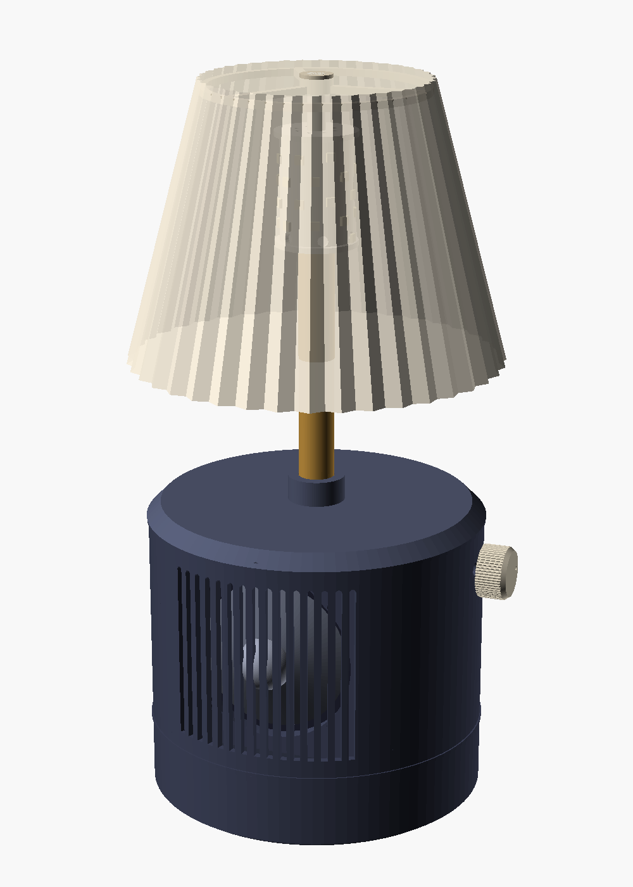
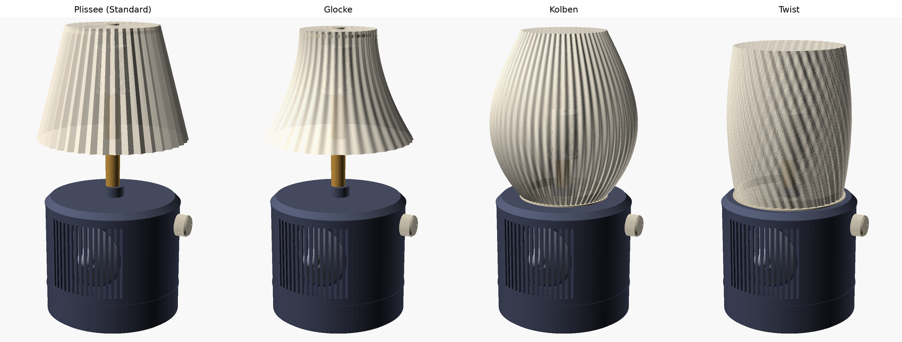
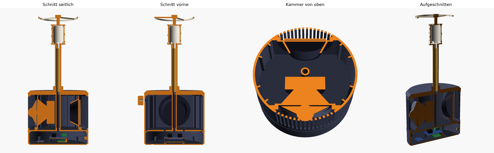

# Gehäuse: Retro-Soundlampe



Parametrisches OpenSCAD-Modell: [`soundlampe.scad`](soundlampe.scad). Fertige STL-Dateien liegen in [`stl/`](stl/).

- **Fuß (Ø 190 × 160 mm):** Unten ein Elektronikfach, darüber eine dichte Lautsprecherkammer mit ca. 2,6 l. Vorne sitzt der 4"-Breitbänder, hinten die Passivmembran, beide hinter senkrechten Lamellen im Stil alter Röhrenradios. Oben auf dem Deckel sitzt der Drehknopf.
- **Stiel:** Messingrohr 20 mm oder gedruckt. Das LED-Kabel läuft innen durch.
- **Lichtkern:** Eine Spule (Ø 40 mm), um die der SK6812-Strip spiralförmig gewickelt wird. 0,5 m ergeben 4 Windungen.
- **Schirm:** vier Varianten zur Auswahl (Parameter `shade_style`), alle gerippt und im Vasenmodus druckbar, siehe unten.
- **Drehknopf:** seitlich rechts am Fuß (`knob_pos = "side"`), damit er bei den Kugelschirmen nicht unter dem Glas verschwindet. `knob_pos = "top"` setzt ihn wie früher in den Deckel.
- **Gesamthöhe:** ca. 41 cm mit Plissee-Schirm, die Kugelschirme sind etwas niedriger

## Schirm-Varianten



| `shade_style` | Form | Montage | Hinweise |
|---|---|---|---|
| `plissee` (Standard) | klassischer Faltenkegel, Ø 210 mm | auf dem Messingstiel, Spinne `spider_plissee.stl` | klassische Nachttischlampe |
| `glocke` | ausgestellte Glocke, 36 Rippen | auf dem Messingstiel, Spinne `spider_glocke.stl` | weicheres, nach unten gerichtetes Licht |
| `kolben` | bauchige Kugel, 56 feine Rippen | steht auf `globe_seat.stl` direkt auf dem Fuß, kurzer Stiel `stem_short.stl` | wirkt wie Riffelglas. Unten ca. 45° Überhang, langsam drucken (Außenwand 25 mm/s), Lüfter 100 % |
| `twist` | leicht bauchiger Zylinder, 40 Rippen mit 50° Drehung | wie `kolben` | moderner Look, druckt am problemlosesten |

Alle Schirme sind eigene, parametrische Entwürfe. Rippenzahl, Tiefe, Drehung und Höhe stehen in der Tabelle `style()` in `soundlampe.scad` und lassen sich frei ändern.

## Ansichten und Schnitte




Einzelbilder liegen in [`renders/`](renders/). Neu rendern: `openscad -D 'part="section_side"' -o renders/section_side.png soundlampe.scad` (Teile: `section_side`, `section_front`, `section_chamber`, `section_electronics`, `exploded`, `cutaway`).

## Teile und Druckeinstellungen

| Teil | Datei | Material | Hinweise |
|---|---|---|---|
| Fußgehäuse | `base_shell.stl` | **PETG** (oder ASA) | aufrecht, **4 mm Wand = 100 % Perimeter** (z. B. 9 Wände bei 0,45 mm), keine Stützen. Mindestens 200 × 200 mm Druckbett |
| Zwischenboden | `divider.stl` | PETG | flach, 100 % Infill |
| Deckel | `top_lid.stl` | PETG | auf dem Kopf drucken (Fase unten), 100 % Infill |
| Kabelrohr | `conduit.stl` | PETG | aufrecht |
| Bodenplatte | `bottom_plate.stl` | PETG | flach |
| Stiel | `stem.stl` (Plissee/Glocke) oder `stem_short.stl` (Kolben/Twist) | PETG | nur wenn kein Messingrohr |
| Lichtkern | `led_core.stl` | PETG | aufrecht |
| Kerndeckel | `core_cap_plissee.stl`, `core_cap_glocke.stl` oder `core_cap_globe.stl` (Kolben/Twist) | PETG | aufrecht |
| Spinne | `spider_plissee.stl` / `spider_glocke.stl` | PETG/PLA | flach, nur Plissee und Glocke |
| Schirmsitz | `globe_seat.stl` | PETG | nur Kolben/Twist, mit 3 × M3 auf den Deckel |
| Schirm | `shade_plissee.stl`, `shade_glocke.stl`, `shade_kolben.stl`, `shade_twist.stl` | **transluzentes** PETG oder PLA (Natur, Elfenbein, „Glass“-PETG) | **Vasenmodus**, 0 Bodenschichten, 0,8 mm Linienbreite |
| Knopf | `knob.stl` | PLA/PETG | aufrecht. Hell oder Messingfarbe sieht retro aus |

## Akustik und Material

- **Bassreflex:** Ja, aber als **Passivmembran** statt Rohr. Sie arbeitet wie ein Reflexport (gleiche Abstimmung, mehr Bass), braucht in 2,6 l aber kein langes Rohr und erzeugt keine Strömungsgeräusche. Das ist nachts bei leisem Rauschen wichtig.
- **Dämmung:** Polyesterwatte locker in die Kammer, dazu **Alubutyl-Dämmmatte** (z. B. Reste aus der Autodämmung, 2 mm) innen an die beiden großen Seitenflächen kleben. Das nimmt den „Plastikklang“ weg.
- **Steifigkeit:** 4 mm Wand mit 100 % Perimetern plus 8 senkrechte Versteifungsrippen in der Kammer. Ein so gedrucktes Teil ist praktisch massiv und schwingt kaum.
- **Material:** **PETG** für den Fuß. PLA wäre sogar etwas steifer, wird aber ab ca. 55 °C weich und kriecht unter den Schraubeinsätzen, und im Fuß sitzt der Verstärker. ASA geht auch, braucht aber ein geschlossenes Druckergehäuse. Holz-PLA oder Füllmaterial bringt akustisch nichts.
- **Dicht:** Deckel, Zwischenboden und die Durchführung des Drehgebers mit Moosgummi bzw. Silikon abdichten. Eine undichte Kammer kostet mehr Bass als jedes Material.

STL neu erzeugen, z. B. nach geänderten Lautsprechermaßen:

```bash
for p in base_shell divider top_lid conduit bottom_plate stem stem_short led_core globe_seat knob; do
  openscad -D "part=\"$p\"" -o stl/$p.stl soundlampe.scad
done
for st in plissee glocke kolben twist; do   # Schirm, Spinne und Kerndeckel je Variante
  for p in shade spider core_cap; do
    openscad -D "part=\"$p\"" -D "shade_style=\"$st\"" -o stl/${p}_$st.stl soundlampe.scad
  done
done   # spider_kolben/twist nicht nötig, core_cap ist bei kolben und twist gleich (core_cap_globe)
```

**Vor dem Druck prüfen:** Die Maße der Chassis (`drv_*`, `pr_*`) stammen nicht aus einem Datenblatt. Bitte mit dem gekauften Lautsprecher vergleichen: Flanschdurchmesser, Ausschnitt, Lochkreis und Einbautiefe (max. ca. 55 mm, sonst stößt der Magnet an das Kabelrohr).

## Zusammenbau

1. Gewindeeinsätze setzen: 4 × in die Dome für die Bodenplatte und 4 + 4 × in die Schallwände für die Chassis-Schrauben. Für den Zwischenboden den Zwischenboden selbst als Bohrschablone auf den unteren Ring legen, 6 Löcher mit 4 mm vorbohren und Einsätze setzen. Alternativ den Zwischenboden nur einkleben und mit Silikon abdichten.
2. Breitbänder von innen auf die vordere Schallwand schrauben, Passivmembran auf die hintere. Flansche jeweils mit Moosgummi abdichten.
3. Lautsprecherkabel und Kabelrohr durch den Zwischenboden führen. Zwischenboden mit Dichtband einsetzen und verschrauben, Durchführungen mit Silikon schließen.
4. Polyesterwatte locker in die Kammer legen, Breitbänder und Membran frei lassen.
5. Drehgeber von innen in das seitliche Loch der Kammer schrauben (Mutter außen auf der flachen Senkung, Gewinde mit etwas Silikon abdichten). Die Drehgeber-Kabel mit dem Lautsprecherkabel durch den Zwischenboden nach unten führen. Das LED-Kabel von oben durch das Rohr nach unten führen. Deckel mit Dichtband aufsetzen, Rohrenden abdichten.
6. Unten: Den Pi Zero auf die 4 kurzen Dome schrauben, an den beiden Stiftleisten-Löchern 11-mm-Abstandsbolzen (M2,5) aufsetzen und den DigiAMP+ obendrauf stecken. Er liegt auf den Bolzen und den zwei hohen Domen auf. Step-down aufschrauben, DC-Buchse einsetzen, alles verdrahten (siehe [HARDWARE.md](../docs/HARDWARE.md)).
7. Stiel in den Deckel stecken (bei Bedarf einkleben). Den LED-Strip spiralförmig um den Lichtkern kleben, Kern auf den Stiel stecken, Kerndeckel aufsetzen.
8. Plissee/Glocke: Spinne auf den Stift setzen und den Schirm von oben darüberstülpen. Kolben/Twist: `globe_seat` mit 3 × M3 auf den Deckel schrauben, kurzen Stiel und Kern einsetzen, Schirm auf den Sitz stellen.
