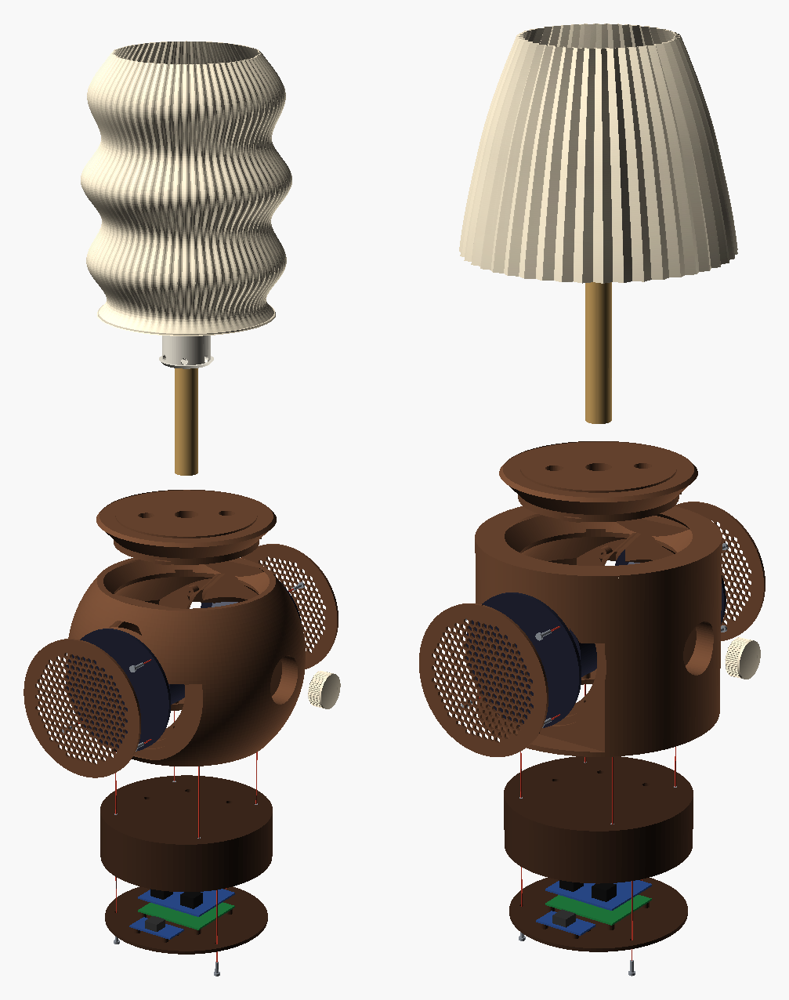

# Soundlampe – eigene Hardware für Dusk & Dawn

Optionaler Zusatz zur Integration: eine Nachttischlampe mit Lautsprecher, die die Klänge selbst berechnet (ohne Verzögerung, Wecker auch ohne WLAN) und über MQTT in Home Assistant erscheint. Musik spielt sie per AirPlay 2, Spotify Connect und Music Assistant.

## Ich will eine bauen

1. **Variante wählen** und den passenden Ordner aus [`pakete/`](pakete/README.md) nehmen: Kugel oder Zylinder, dazu Plissee, Glocke, Kolben, Twist oder Laterne. Darin liegen alle STL, die Druckeinstellungen für den Bambu Lab P1S und die Schraubenliste.
2. **Teile kaufen:** [docs/HARDWARE.md](docs/HARDWARE.md)
3. **Zusammenbauen** mit Bildern zu jedem Schritt: [Montageanleitung (PDF)](docs/pdf/Soundlampe_Montageanleitung.pdf). Elektronik, Löten und Stromlaufplan: [Bauanleitung (PDF)](docs/pdf/Soundlampe_Bauanleitung.pdf).
4. **Einrichten** (Pi, Home Assistant): [docs/SETUP.md](docs/SETUP.md)

## Ordner

| Ordner | Inhalt |
|---|---|
| [`pakete/`](pakete/README.md) | 10 fertige Druckpakete, eins pro Variante |
| [`gehaeuse/`](gehaeuse/README.md) | OpenSCAD-Modell, Konstruktionsplan, Renderbilder, Werkzeuge zum Neuexportieren |
| [`device/`](device) | Software für den Raspberry Pi: Sound-Engine, Licht, Drehknopf, MQTT |
| [`docs/`](docs) | Hardware-Liste, Aufbau, Einrichtung, Verdrahtung, PDFs |
| [`homeassistant/`](homeassistant) | Altes YAML-Paket für die Lampe ohne Integration (nicht mehr nötig) |
