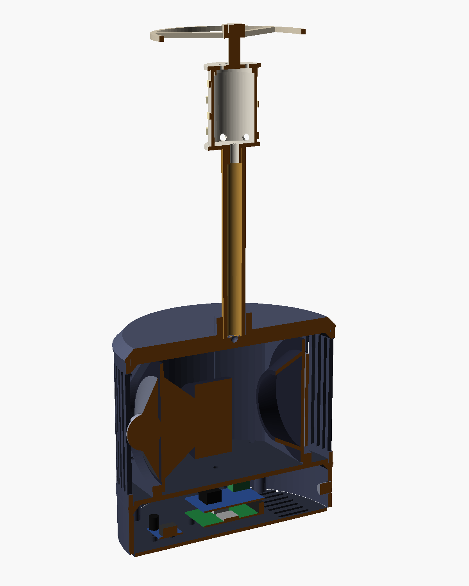
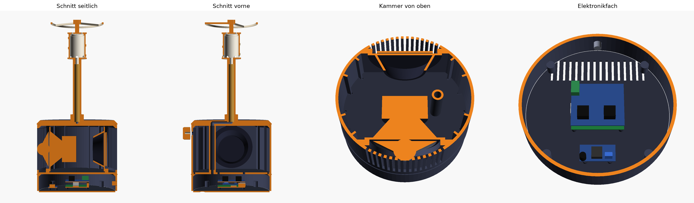
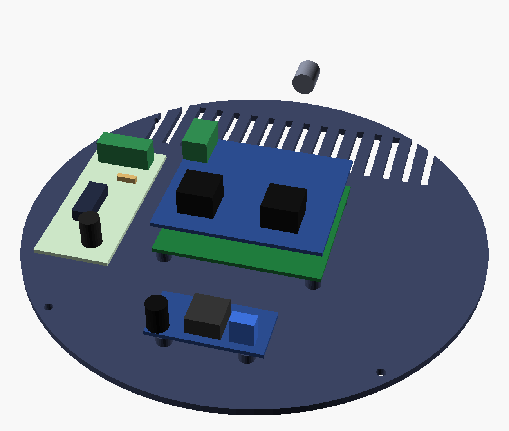
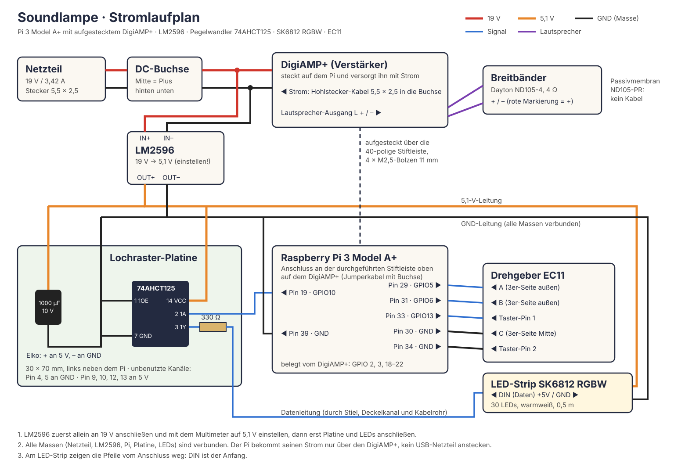
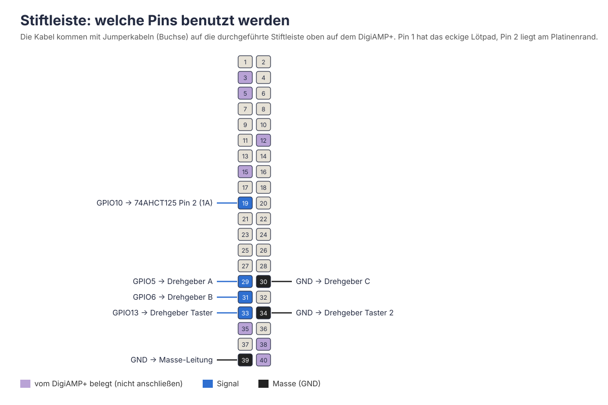
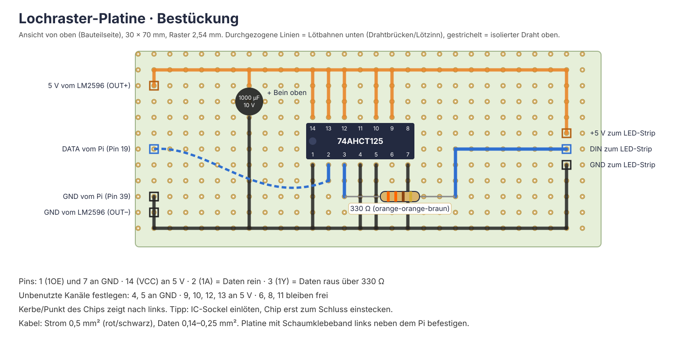
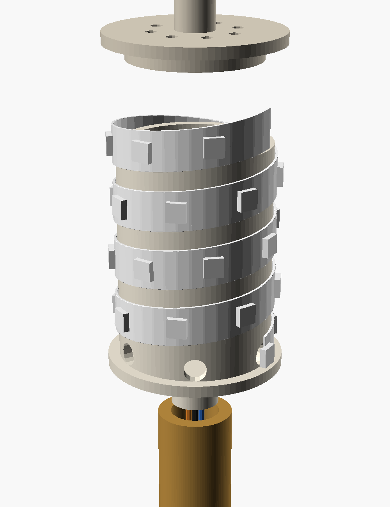
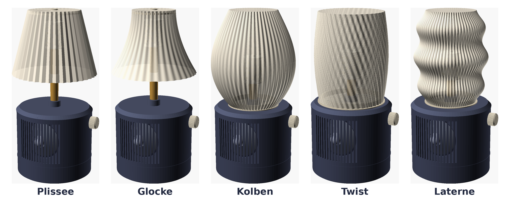
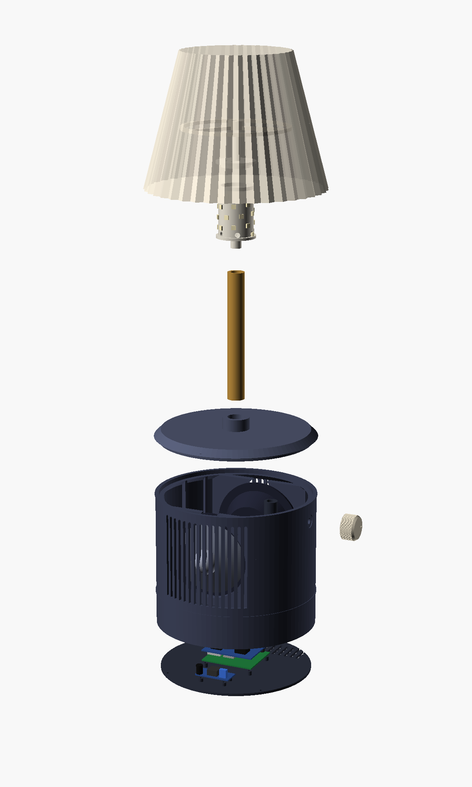

# Aufbau der Lampe

Dieses Dokument erklärt, wie die Soundlampe innen aufgebaut ist und in welcher Reihenfolge man sie zusammensetzt. Druckeinstellungen und Teileliste stehen in [`gehaeuse/README.md`](../gehaeuse/README.md), Bezugsquellen in [`HARDWARE.md`](HARDWARE.md).

## Die drei Etagen

Die Lampe ist von unten nach oben in drei Bereiche geteilt:

| Etage | Was drin ist | Warum so |
|---|---|---|
| **Elektronikfach** (unten, ca. 30 mm hoch) | Raspberry Pi 3 A+ mit DigiAMP+, LM2596-Spannungswandler, Lochraster-Platine, DC-Buchse | Wärme und Elektronik bleiben aus der Lautsprecherkammer raus. Lüftungsschlitze in der Bodenplatte, 3 Gummifüße lassen Luft drunter |
| **Lautsprecherkammer** (Mitte, gut 2 l) | Dayton ND105-4 vorne, Passivmembran ND105-PR hinten, Dämmung, Drehgeber an der Seite | luftdicht, 4 mm Wand mit 8 Rippen: so klingt ein kleiner Lautsprecher nach mehr |
| **Licht** (oben) | Messingstiel, Lichtkern mit LED-Spirale, Schirm | Licht weit oben, Kabel innen versteckt |

Zwischen Kammer und Elektronikfach liegt der Zwischenboden, oben schließt der Deckel die Kammer ab. Durch die Kammer führt seitlich (45 mm neben der Mitte) ein dichtes Kabelrohr. Durch dieses Rohr läuft das LED-Kabel nach unten, ohne dass Luft aus der Kammer entweicht. Mittig wäre kein Platz: Der Magnet des ND105-4 reicht 67 mm tief nach hinten.

## Elektronikfach

- **Pi 3 A+ und DigiAMP+** sind ein Turm: Der Pi sitzt auf 4 kurzen Domen, darauf 4 Abstandsbolzen M2,5 × 11 mm, darauf der DigiAMP+. Der Verstärker versorgt den Pi über die Stiftleiste mit Strom. Der Pi bekommt **kein** eigenes USB-Netzteil.
- **LM2596** vorne auf 4 Domen: macht aus 19 V die 5,1 V für die LEDs. Vor dem ersten Anschließen mit dem Multimeter einstellen.
- **Lochraster-Platine** (30 × 70 mm) links neben dem Pi, mit Schaumklebeband: Pegelwandler, Elko und Widerstand für die LED-Datenleitung.
- **DC-Buchse** hinten unten: Hier kommt das 19-V-Netzteil rein.

### Stromlaufplan

### Pi-Stiftleiste

Alle Kabel zum Pi werden oben auf die durchgeführte Stiftleiste des DigiAMP+ gesteckt (Jumperkabel mit Buchse). Der DigiAMP+ belegt selbst GPIO 2, 3 und 18–22. Die Lampe nutzt nur andere Pins.

| Pin | Funktion | geht an |
|---|---|---|
| 19 (GPIO10, SPI MOSI) | LED-Daten | Platine, 74AHCT125 Pin 2 |
| 39 | GND | Platine, GND |
| 29 (GPIO5) | Drehgeber A | EC11 A |
| 31 (GPIO6) | Drehgeber B | EC11 B |
| 30 | GND | EC11 C (Mitte) |
| 33 (GPIO13) | Taster | EC11 Taster 1 |
| 34 | GND | EC11 Taster 2 |

### Lochraster-Platine

Warum der Chip? Der Pi gibt 3,3-V-Signale aus, die SK6812-LEDs erwarten bei 5 V mindestens etwa 3,5 V. Das klappt oft, aber nicht zuverlässig, und dann flackern einzelne LEDs. Der 74AHCT125 hebt das Signal sauber auf 5 V. Der 330-Ω-Widerstand dämpft Reflexionen auf der langen Leitung durch den Stiel. Der 1000-µF-Elko fängt Stromspitzen ab, wenn alle LEDs gleichzeitig einschalten.

## Lichtkern und LEDs

- **Lichtkern:** eine hohle Spule mit Ø 40 mm (Umfang 126 mm) aus PETG, die oben auf dem Messingstiel steckt. Unten hat sie einen Flansch und 6 Lüftungslöcher. Der Kerndeckel oben hat 8 Löcher, damit die warme Luft nach oben abzieht (Kamineffekt).
- **LED-Strip:** 0,5 m SK6812 RGBW warmweiß, 60 LEDs/m = **30 LEDs**, in **4 Windungen** mit 15 mm Steigung spiralförmig um den Kern geklebt. Die LEDs zeigen nach außen und leuchten den Schirm von innen gleichmäßig an. Die Spirale verteilt das Licht rundum ohne dunkle Streifen.
- **Richtung:** Der Strip beginnt **unten** mit dem Anschluss (DIN). Die kleinen Pfeile auf dem Strip zeigen vom Anschluss weg, also nach oben.
- **Kabel:** 3 Adern (5 V rot, GND schwarz, Daten z. B. blau) gehen am Anfang des Strips durch ein Loch in den Kern, durch den Stiel nach unten, durch den Kanal im Deckel und dann durch das Kabelrohr ins Elektronikfach. Ein Draht als Zugband hilft beim Durchziehen.
- **Strom:** Warmweiß nutzt fast nur den weißen Kanal, das sind etwa 20 mA pro LED, also 0,6 A bei voller Helligkeit. Die Software begrenzt auf 70 % (`max_brightness`), damit es im Schirm nicht zu warm wird. Bei voller RGBW-Helligkeit wären es bis zu 2,4 A, das schafft der LM2596 ebenfalls.
- **Lichtfarben:** 1800–6500 K über die Mischung aus Weiß und RGB, Effekte Sonnenaufgang (rot → orange → warmweiß), Kerze (flackernde Einzel-LEDs um 1800–2200 K) und Einschlafen (dunkler werdend mit dem Sleep-Timer).

## Schirme

Alle fünf Schirme sind eigene Entwürfe und werden im Vasenmodus aus transluzentem Filament gedruckt. Die feinen Rippen brechen das Licht wie Riffelglas. Plissee und Glocke hängen an einer Spinne über dem Lichtkern. Kolben, Twist und die neue **Laterne** (gestufte Kugel mit drei Wülsten und 72 Rippen) stehen auf einem Schirmsitz direkt auf dem Fuß.

## Zusammenbau Schritt für Schritt

1. **Drucken** (siehe Druckeinstellungen) und Gewindeeinsätze M3 einschmelzen.
2. **Lautsprecher:** Breitbänder von innen vorne, Passivmembran von innen hinten anschrauben, Flansche mit Moosgummi abdichten. Lautsprecherkabel anlöten (rote Markierung = +).
3. **Drehgeber** von innen in das seitliche Loch, Mutter außen, Gewinde mit Silikon dichten. 5 Litzen anlöten (A, B, C, Taster 1, Taster 2).
4. **Kabelrohr und Zwischenboden:** Rohr einsetzen, Kabel von Lautsprecher und Drehgeber durch den Zwischenboden nach unten führen, Zwischenboden mit Dichtband einsetzen, Durchführungen mit Silikon schließen.
5. **Dämmen:** Alubutyl an die Kammerwände, Polyesterwatte locker hinein, Lautsprecher frei lassen.
6. **Deckel und LED-Kabel:** Zugdraht von oben durch Stiel, Deckelkanal und Kabelrohr schieben, LED-Kabel durchziehen, Deckel mit Dichtband aufsetzen, Rohrenden abdichten.
7. **Lichtkern:** Strip spiralförmig um den Kern kleben (Anschluss unten), Kabel anlöten, Kern auf den Stiel, Kerndeckel drauf.
8. **Elektronik:** LM2596 zuerst **allein** an 19 V anschließen und auf 5,1 V einstellen. Dann Pi und DigiAMP+ als Turm einbauen, Platine löten (siehe Plan) und einkleben, alles nach dem Stromlaufplan verkabeln, DC-Buchse einsetzen.
9. **Erster Test** mit offener Bodenplatte: Netzteil rein, nach etwa einer Minute erscheint die Lampe in Home Assistant. LEDs, Drehknopf und Ton prüfen.
10. **Schließen:** Bodenplatte anschrauben, Gummifüße aufkleben, Schirm aufsetzen.

Die Software-Installation steht in [`SETUP.md`](SETUP.md).
