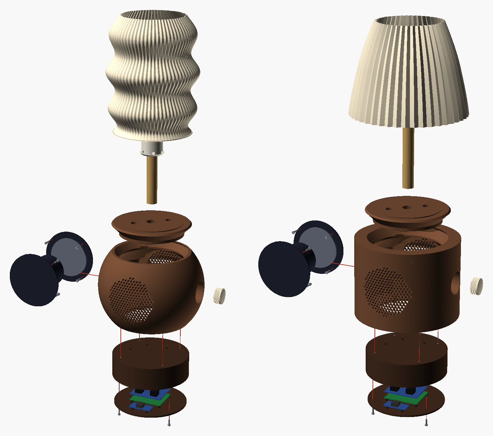
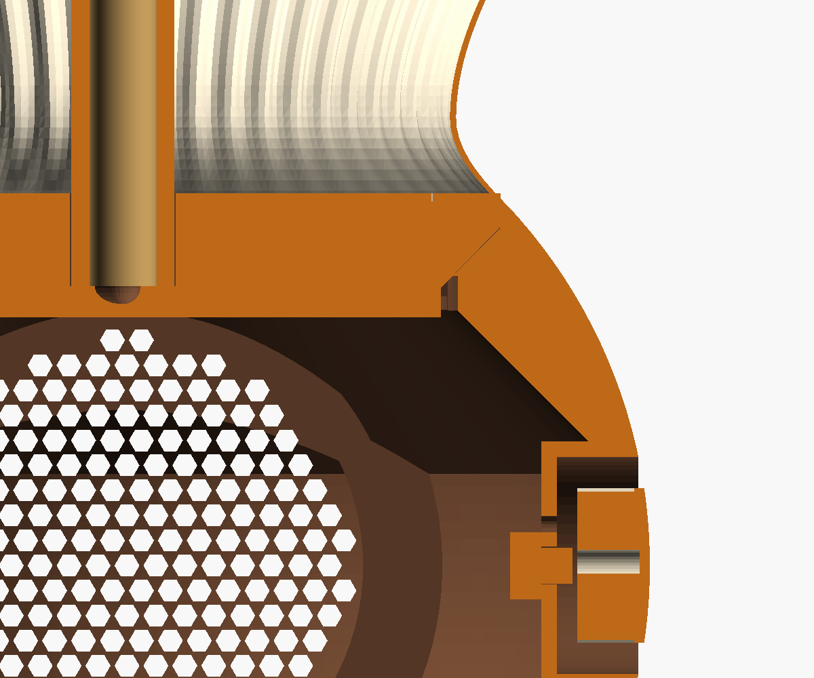

# Gehäuse v2

Ein OpenSCAD-Modell für beide Füße (Kugel, Zylinder) und alle fünf Schirme: [`soundlampe.scad`](soundlampe.scad). Die verbindlichen Regeln (Drucker, Schrauben, Verbindungen) stehen im [Konstruktionsplan](KONSTRUKTIONSPLAN.md). Fertige STL gibt es in den [Druckpaketen](../pakete/README.md).



## Das Wichtigste

- **Keine sichtbaren Schrauben.** Die Kugel bleibt rund, das Lochfeld ist in die Wand gedruckt. Die Lautsprecher sitzen dahinter auf einer inneren Schallwand und werden von innen mit selbstschneidenden Schrauben direkt hineingeschraubt. Der Körper wird von unten aus dem Sockel verschraubt, die Bodenplatte unter den Gummifüßen.
- **Nur selbstschneidende Linsenkopfschrauben** (BT3, BT2.6), keine Senkköpfe, keine Gewindeeinsätze.
- **Bajonett-Deckel:** eine Drittel-Drehung, kein Werkzeug. Sein Rand ist das fehlende Stück Kugel, darunter ein 45°-Konus. Er druckt mit der Oberseite nach oben ohne Stützen.
- **Knopf bündig in einer Mulde** (Ø 42 × 18 mm, Knopf Ø 30 mm mit Kugel-Oberfläche). Nur die Decke der Mulde braucht Tree Supports.
- **Schirme oben und unten offen.** Kolben, Twist und Laterne stehen direkt in einer Ringmulde im Deckel und beginnen mit genau dem Kugeldurchmesser und der Kugelneigung an dieser Stelle. Kein Adapterring, kein Absatz.
- **Gleiche Teile für beide Füße:** Sockel, Bodenplatte, Deckel, Knopf, Stiele, Lichtkern, Kerndeckel, Spinnen, Schirme. Nur der Körper unterscheidet sich.



## Bilder

| Bild | Inhalt |
|---|---|
| [explosion_kugel.png](renders/explosion_kugel.png), [explosion_zylinder.png](renders/explosion_zylinder.png) | Explosionszeichnungen mit Montagereihenfolge und Schraubenwegen (rot) |
| [schnitt_kugel.png](renders/schnitt_kugel.png), [schnitt_zylinder.png](renders/schnitt_zylinder.png) | Schnitt durch die Lautsprecherachse |
| [detail_knopf_deckel_kugel.png](renders/detail_knopf_deckel_kugel.png), [_zylinder](renders/detail_knopf_deckel_zylinder.png) | Knopfmulde, Bajonett und Übergang Kugel / Deckel / Schirm |
| [alle_varianten.png](renders/alle_varianten.png) | Alle 10 Kombinationen |

## Modell benutzen

```
openscad -D 'base="kugel"' -D 'shade_style="laterne"' -D 'part="assembly"' soundlampe.scad
```

`part`: `assembly`, `exploded`, `section`, `section_knob`, `step` (mit `step=1…8`, Bilder der Montageanleitung) oder ein Einzelteil: `body`, `plinth`, `plate`, `lid`, `knob`, `stem`, `led_core`, `core_cap`, `spider`, `shade`.

## Neu exportieren

```
cd werkzeug
./export_alle.sh /tmp/stl_roh                     # alle Teile als STL (dauert ein paar Minuten)
python3 stl_binaer.py /tmp/stl_bin /tmp/stl_roh/*.stl   # binär + Prüfung auf offene Kanten
python3 pakete_bauen.py /tmp/stl_bin <vorschaubilder>   # schreibt ../../pakete/
```

Version 1 (Zylinder mit Zwischenboden und Kugel mit Gewindeeinsätzen) liegt unverändert in [`archiv/`](archiv/).
