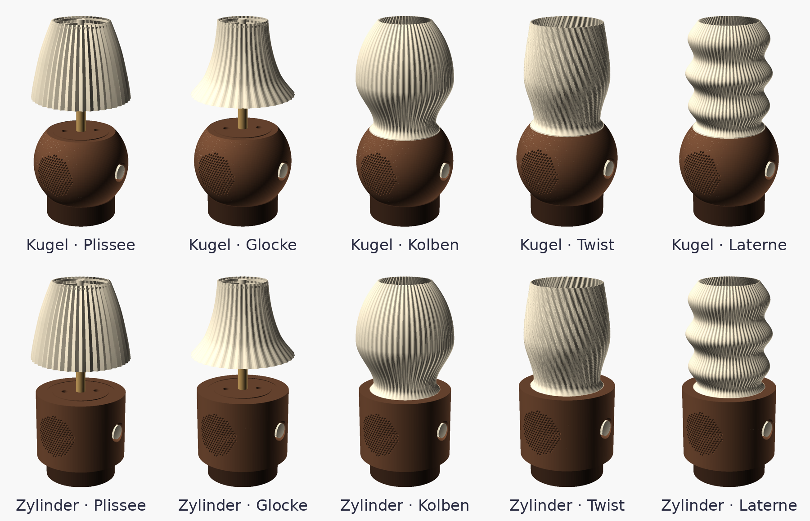

# Druckpakete

Ein Ordner pro Variante. Jeder enthält alle STL-Dateien (schon richtig auf der Druckplatte ausgerichtet), ein Vorschaubild und ein README mit Stückzahlen, Stützen und Einstellungen für den Bambu Lab P1S, Schrauben und Stiellänge.

| | Plissee | Glocke | Kolben | Twist | Laterne |
|---|---|---|---|---|---|
| **Kugel** | [kugel-plissee](kugel-plissee/) | [kugel-glocke](kugel-glocke/) | [kugel-kolben](kugel-kolben/) | [kugel-twist](kugel-twist/) | [kugel-laterne](kugel-laterne/) |
| **Zylinder** | [zylinder-plissee](zylinder-plissee/) | [zylinder-glocke](zylinder-glocke/) | [zylinder-kolben](zylinder-kolben/) | [zylinder-twist](zylinder-twist/) | [zylinder-laterne](zylinder-laterne/) |

**Gleich in jedem Paket:** Sockel, Bodenplatte, Deckel, Knopf, Lichtkern. **Je nach Fuß:** der Körper. **Je nach Schirm:** Schirm, Stiel (140 mm für Plissee/Glocke, 95 mm für Kolben/Twist/Laterne), Kerndeckel und bei Plissee/Glocke die Spinne.

Einen einzelnen Ordner herunterladen geht z. B. über *download-directory.github.io* mit dem Link zum Ordner, oder das ganze Repo als ZIP.

Die Pakete werden aus [`../gehaeuse/soundlampe.scad`](../gehaeuse/soundlampe.scad) erzeugt, siehe [Gehäuse-README](../gehaeuse/README.md#neu-exportieren).
