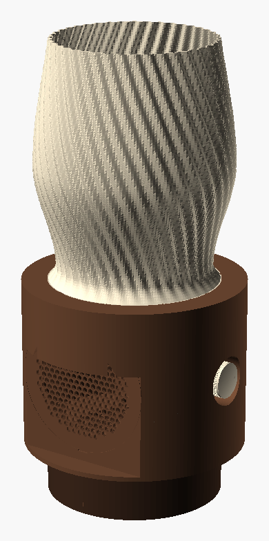

# Paket: Zylinder mit Schirm Twist

Alles, was du für diese Variante druckst, liegt in diesem Ordner. Die STL-Dateien sind schon richtig auf der Druckplatte ausgerichtet, einfach in Bambu Studio laden.

Schirm: **Twist**, gedrehte Rippen, steht im Deckel. Stiel: **95 mm**.

## Druckteile

| Datei | Anzahl | Teil | Filament | Stützen | Hinweis |
|---|---|---|---|---|---|
| `01_koerper_zylinder.stl` | 1 | Körper (Zylinder) | Gehäusefarbe | **Tree Supports (manuell)**: nur die Decke der Knopfmulde anmalen | liegt richtig herum, Flansch auf der Platte |
| `02_sockel.stl` | 1 | Sockel | Gehäusefarbe | keine | steht kopfüber (Decke auf der Platte) |
| `03_bodenplatte.stl` | 1 | Bodenplatte | Gehäusefarbe | keine |  |
| `04_deckel.stl` | 1 | Deckel (Bajonett) | Gehäusefarbe | keine | Oberseite nach oben |
| `05_gitter.stl` | 2 | Lautsprechergitter | Gehäusefarbe | keine | **2 × drucken** |
| `06_knopf.stl` | 1 | Drehknopf | Akzentfarbe | keine | Rückseite auf der Platte |
| `07_stiel_95mm.stl` | 1 | Stiel 95 mm | Akzent oder Messing | keine | oder Messingrohr Ø 20 mm außen, ≥ 13 mm innen, 95 mm lang |
| `08_lichtkern.stl` | 1 | Lichtkern | Weiß | keine | kopfüber, die kleine Brücke im Boden druckt frei |
| `09_kerndeckel.stl` | 1 | Kerndeckel | Weiß | keine | flach auf der Platte, Stift nach oben |
| `11_schirm_twist.stl` | 1 | Schirm Twist | Weiß/Natur, lichtdurchlässig | keine | 3 Wände, 0 % Füllung, keine obere/untere Deckschicht nötig (Schirm ist offen) |

### Einstellungen (Bambu Lab P1S, 0,4-mm-Düse)

- **Gehäuseteile** (Körper, Sockel, Platte, Deckel, Gitter, Knopf): PLA oder PETG, 0,2 mm Schicht, 3 Wände, 15 % Gyroid. Alle Teile passen einzeln auf die 256 × 256-Platte, der Körper ist das größte Teil.
- **Stützen**: global **aus**. Nur beim Körper: Stütztyp *Tree (manuell)* und mit dem Pinsel nur die runde Decke der Knopfmulde anmalen. Alles andere ist auf höchstens 45° oder als kurze Brücke konstruiert.
- **Schirm**: helles PLA, 0,2 mm Schicht, 3 Wände (= 1,2 mm), 0 % Füllung. Ohne Stützen, der Schirm ist oben und unten offen.
- **Lichtkern und Kerndeckel**: weißes PLA, wie Gehäuse.

## Schrauben und Kleinteile

| Schraube | Anzahl | Wofür | Werkzeug |
|---|---|---|---|
| BT3 × 12, Linsenkopf, selbstschneidend | 8 | Breitbänder und Passivmembran auf die Schallwände (von außen, unter den Gittern) | Kreuz PH1 |
| BT3 × 10, Linsenkopf, selbstschneidend | 4 | Körper auf den Sockel (von unten aus dem Sockel) | Kreuz PH1 |
| BT3 × 10, Linsenkopf, selbstschneidend | 3 | Bodenplatte an den Sockel (unter den Gummifüßen) | Kreuz PH1 |
| BT2.6 × 6, Linsenkopf, selbstschneidend | 2 | LM2596 auf die Bodenplatte | Kreuz PH0 |
| Abstandsbolzen M2,5 × 11 (Innen/Außen) + M2,5 × 5 | 4 + 4 | Pi und DigiAMP+ (die Bolzen schneiden ihr Gewinde selbst in die Dome) | Steckschlüssel 5 mm |

Keine Senkkopfschrauben, keine Gewindeeinsätze. Alle selbstschneidenden Schrauben gibt es z. B. im Bambu Lab Maker's Supply.

Außerdem: 3 Gummifüße Ø 12 mm (decken die Bodenschrauben ab), Moosgummi-Dichtband 3 mm, etwas Silikon für die Kabeldurchführungen, ca. 30 g Polyesterwatte.

Elektronik und Lautsprecher: siehe [Hardware-Liste](../../docs/HARDWARE.md).

## Schirm befestigen

Der Schirm steht mit seinem Fußring in der Ringmulde oben im Deckel und läuft bündig aus der Körperkontur heraus. Kein Adapterring, keine Schrauben. Wer ihn gegen Verrutschen sichern will, legt ein Stück Silikon-Klebeband in die Mulde.

## Zusammenbauen

Schritt für Schritt mit Bildern: [Montageanleitung (PDF)](../../docs/pdf/Soundlampe_Montageanleitung.pdf). Maße und Konstruktionsregeln: [Konstruktionsplan](../../gehaeuse/KONSTRUKTIONSPLAN.md).
